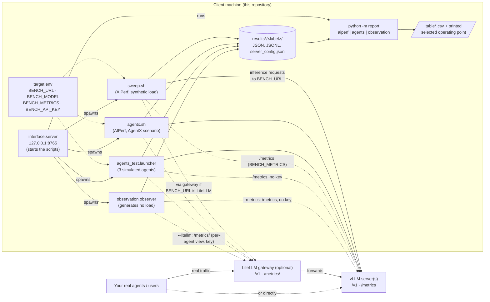

# banc-gpu
<a id="top"></a>

*Banc* is the French word for bench; the repository keeps the name `banc-gpu` so that its URL stays stable.

A capacity benchmark for a model served by vLLM: for a given installation, how many simultaneous
requests (or agent tasks) it sustains, and at what throughput per GPU, as long as each request receives
its tokens at a target speed (the **interactivity**, in tokens/s per request).

Two families of measurements:

- **stress tests**: the bench generates the load itself, in increasing levels, until the installation breaks;
  they give the installation's **capacity**;
- **observation**: the bench generates nothing; it reads vLLM's metrics while your real agents
  run, and tells you whether the installation **sustains the real load**, per window, per period and per agent.

> **Status.** Written from the code of **vLLM at commit [`7f855f6`](https://github.com/vllm-project/vllm/tree/7f855f605892656ebf7265642e5d22a34a6ae731)**
> and tested with **AIPerf 0.12.0** against the fake server ([section 6](#6-smoke-test-without-a-gpu)),
> before the rename of the code to English. After the rename, the launcher, the observer and the report kinds were
> re-run against the fake server and the test suite passes; `sweep.sh` and `agentx.sh` (which need AIPerf) were
> **not** re-run (command to run: the smoke test of [section 6](#6-smoke-test-without-a-gpu)).
> **It has not yet been run against a real vLLM.** The per-agent view
> ([section 8.4](#84-per-agent-view-through-litellm), way 2) was checked with a real LiteLLM (1.109.1).
> On your first real run, compare your outputs with the example in [section 5.4](#54-test-the-connection).
> Unfamiliar terms: see [Appendix E](#appendix-e-glossary).
> Statements that are documented, inferred or not verified are collected in the
> [Validation status](#validation-status) box below.

### Validation status

| Status | What | Where |
|---|---|---|
| Verified | Pipeline against the fake server before the English rename; after it, only the launcher, the observer, the three report kinds and the test suite were re-run (`sweep.sh` and `agentx.sh` were not); per-agent view with a real LiteLLM 1.109.1 (metric names, types, labels, Prisma and `prometheus_client` requirements) | [section 6](#6-smoke-test-without-a-gpu), [section 8.4](#84-per-agent-view-through-litellm), [Appendix B](#appendix-b-litellm-per-key-setup-and-install-details) |
| Documented (code or help text) | AgentX scenario rules (AIPerf `inferencex_agentx_mvp.py`); `--max-context-length` (AIPerf help); `get_max_tokens` reduces `max_tokens` (vLLM code); histogram and client-abort behaviour (`stats.py`); unknown request fields ignored by vLLM (`protocol.py`) | [section 7.3](#73-agentx-stress-test), [section 7.5](#75-agentx-on-a-small-model), [section 8.1](#81-tune-vllm-for-exact-interactivity), [section 8.4](#84-per-agent-view-through-litellm) |
| Inferred, to check on first use | Chat template adds tokens beyond the trace lengths; `--max-num-seqs` for AgentX (sessions x parallel sub-agents); name and labels of the `http_requests_total` counter (the `err` column shows "—" otherwise); bias toward short sessions in a `BENCH_MAX_CONTEXT` replay | [section 4.2](#42-vllm-launch-options), [section 7.5](#75-agentx-on-a-small-model), [section 8.1](#81-tune-vllm-for-exact-interactivity) |
| Not verified | That the AgentX Hugging Face repository stores one trace per JSON file in one folder (the download script counts the files); that LiteLLM forwards `min_tokens` / `ignore_eos` | [section 7.4](#74-agentx-without-internet-access), [section 7.7](#77-stress-test-through-litellm) |

## Contents

- [1. Choose a mode](#1-choose-a-mode)
- [2. Quick start](#2-quick-start)
- [3. How the pieces connect](#3-how-the-pieces-connect)
- [4. Requirements and installation](#4-requirements-and-installation)
  - [4.1 What must already be in place](#41-what-must-already-be-in-place)
  - [4.2 vLLM launch options](#42-vllm-launch-options)
  - [4.3 Install the bench](#43-install-the-bench)
- [5. Configure the client](#5-configure-the-client)
  - [5.1 Activate the environment](#51-activate-the-environment)
  - [5.2 Set the connection](#52-set-the-connection)
  - [5.3 Copy the tokenizer](#53-copy-the-tokenizer)
  - [5.4 Test the connection](#54-test-the-connection)
- [6. Smoke test without a GPU](#6-smoke-test-without-a-gpu)
- [7. Stress tests](#7-stress-tests)
  - [7.1 Synthetic stress test](#71-synthetic-stress-test)
  - [7.2 Reading the stress-test report](#72-reading-the-stress-test-report)
  - [7.3 AgentX stress test](#73-agentx-stress-test)
  - [7.4 AgentX without Internet access](#74-agentx-without-internet-access)
  - [7.5 AgentX on a small model](#75-agentx-on-a-small-model)
  - [7.6 Test-agents stress test](#76-test-agents-stress-test)
  - [7.7 Stress test through LiteLLM](#77-stress-test-through-litellm)
- [8. Observation (real use)](#8-observation-real-use)
  - [8.1 Tune vLLM for exact interactivity](#81-tune-vllm-for-exact-interactivity)
  - [8.2 Observe a window](#82-observe-a-window)
  - [8.3 Per-period view](#83-per-period-view)
  - [8.4 Per-agent view through LiteLLM](#84-per-agent-view-through-litellm)
- [9. Measurement protocol](#9-measurement-protocol)
- [10. Interface](#10-interface)
- [11. Reference](#11-reference)
  - [11.1 Outputs on disk](#111-outputs-on-disk)
  - [11.2 Repository contents](#112-repository-contents)
  - [11.3 Troubleshooting](#113-troubleshooting)
- [Appendix A. Security notes](#appendix-a-security-notes)
- [Appendix B. LiteLLM per-key setup and install details](#appendix-b-litellm-per-key-setup-and-install-details)
- [Appendix C. Sources](#appendix-c-sources)
- [Appendix D. Tests](#appendix-d-tests)
- [Appendix E. Glossary](#appendix-e-glossary)

---

## 1. Choose a mode

| Mode | Tool | Load | vLLM prefix cache | What it gives | Section |
|---|---|---|---|---|---|
| **Synthetic stress test** | `sweep.sh` (AIPerf) | fixed-length requests | **disabled** | conservative floor | [7.1](#71-synthetic-stress-test) |
| **AgentX stress test** | `agentx.sh` (AIPerf, scenario `inferencex-agentx-mvp`) | replayed public coding-agent sessions | enabled | measurement comparable to InferenceX's AgentX results | [7.3](#73-agentx-stress-test) |
| **Test-agents stress test** | `agents_test/` | three simulated agent profiles | enabled | agent load close to your usage | [7.6](#76-test-agents-stress-test) |
| **Observation** | `observation/` | your agents, in real use | as configured | "does it hold?", per window, period, agent | [8](#8-observation-real-use) |

**Start with the synthetic stress test**: it needs no trace download and is the quickest way to validate your setup.
Use observation instead if you already have agents running in production. Changing the prefix cache
requires restarting vLLM (see [section 4.2](#42-vllm-launch-options)).

[↑ Back to top](#top)

---

## 2. Quick start

A first synthetic measurement (about 15 commands, using a vLLM that is already running).

```bash
git clone https://github.com/Shevehs/banc-gpu.git ~/banc-gpu && cd ~/banc-gpu
python3 -m venv .venv-aiperf && source .venv-aiperf/bin/activate
pip install aiperf==0.12.0 "openai>=1.40" httpx
cp tools/target.env.example target.env       # set BENCH_URL, BENCH_MODEL, BENCH_API_KEY (and BENCH_METRICS if needed)
source target.env
./tools/download_tokenizer.sh <Hugging Face repository of your model>
python tools/server_config.py --url "$BENCH_URL" --model "$BENCH_MODEL" --metrics "$BENCH_METRICS" > /dev/null
./sweep.sh first-r1 "1 4 16"
python -m report aiperf results --target 30 --gpu 8     # set --gpu to the number of GPUs behind the target
```

For this run, vLLM must already serve the model with `--no-enable-prefix-caching`
(see [section 4.2](#42-vllm-launch-options)). The `server_config.py` line must print `[config]` lines
([section 5.4](#54-test-the-connection)). Python 3.11 to 3.13 is required.

Unfamiliar terms: see [Appendix E](#appendix-e-glossary). No GPU at hand? Check the scripts first with the fake server ([section 6](#6-smoke-test-without-a-gpu)).

Next steps: the other stress tests ([section 7](#7-stress-tests)), observation of your real agents
([section 8](#8-observation-real-use)), or the local interface ([section 10](#10-interface)).

[↑ Back to top](#top)

---

## 3. How the pieces connect



Solid arrows are traffic and file writes, dashed arrows are optional paths or metric reads. The observer
never sends load (at most one 1-token completion with `--url` and `--model`, before the first window).
When the target is the LiteLLM gateway, `BENCH_METRICS` must list vLLM's `/metrics` URLs, because the
gateway does not expose them.

[↑ Back to top](#top)

---

## 4. Requirements and installation

### 4.1 What must already be in place

| Requirement | Detail | Check |
|---|---|---|
| **vLLM installed and the model served** | OpenAI-compatible API on `http://<host>:<port>`. The bench does not start vLLM. | `curl -s http://<host>:8000/v1/models` lists the model |
| **vLLM's `/metrics` reachable** from the client machine | Enabled by default; it provides preemptions, cache, speculative decoding, KV cache occupancy. It does **not** require the API key (see [Appendix A](#appendix-a-security-notes)). | `curl -s http://<host>:8000/metrics \| grep -c '^vllm:'` > 0 |
| **LiteLLM installed** (optional) | Only to measure through the gateway. Model declared as `hosted_vllm/<name>` with `api_base: http://<host>:8000/v1` and, if vLLM has a key, `api_key` ([LiteLLM, vLLM](https://docs.litellm.ai/docs/providers/vllm); [configuration](https://docs.litellm.ai/docs/proxy/configs)). | `curl -s -H "Authorization: Bearer <key>" http://<vm>:4000/v1/models` |
| **Python 3.11 to 3.13** on the client machine | Required by AIPerf 0.12. | `python3 --version` |
| **bash** | Tested with bash 5; written for bash 3.2 (macOS), verified only with a bash 3.2 built on Linux. | `bash --version` |
| **Network** | The client machine reaches vLLM (and LiteLLM). No Internet access is needed once the tokenizer is copied into `tools/tokenizer/` ([section 5.3](#53-copy-the-tokenizer)). | — |

The **client machine** is the one that runs the measurements: the same machine as vLLM for a local trial, or
a VM on the same private network as the GPU servers. Do not run the clients on the servers being measured.

### 4.2 vLLM launch options

The bench reads the server configuration, but you choose how vLLM is launched.

**Essential options**

- `--served-model-name <name>` (recommended): the short name you give the bench as `BENCH_MODEL`.
- **Prefix caching**: pass `--no-enable-prefix-caching` for the **synthetic** stress test (AIPerf reuses its
  synthetic prompts, so the cache would inflate throughput); do **not** pass it for AgentX and the test agents
  (agents re-read their context: the cache is part of what is measured); for observation, keep your production setting.
  Changing it requires **restarting vLLM** between the synthetic load and the other modes.
- `--max-model-len`: large enough for the mode (table below). The bench does not truncate.
- `--max-num-seqs`: at least the highest concurrency, otherwise the extra requests wait. AgentX: at least sessions x parallel sub-agents (inferred; keep a margin). Test agents: at least the highest level x 3 (`code_review` launches 3 sub-agents).

| Mode | `--max-model-len` at least | Why |
|---|---|---|
| Synthetic | input + output + chat template (e.g. 2,048 + 256, plus a margin) | requests have a fixed length |
| AgentX | the longest trace context: up to about 990,000 input tokens (full set), 256,000 (`256k` variant); otherwise set `BENCH_MAX_CONTEXT` ([section 7.5](#75-agentx-on-a-small-model)) | AIPerf does not truncate AgentX traces |
| Test agents | about 135,000 x `--scale`, plus the output | contexts reach about 135,000 tokens at scale 1 (estimated with the Qwen vocabulary) |
| Observation | not applicable | the bench sends nothing |

**Optional options**

| `vllm serve` option | Used by | Why |
|---|---|---|
| `--enable-prompt-tokens-details` | test agents (recommended) | each response reports the tokens read from cache |
| `--enable-auto-tool-choice --tool-call-parser <parser>` | test agents, `autonomous` mode only | tool calls chosen by the model |
| `--custom-histogram-buckets '…'` | observation (**recommended**) | histogram bounds at your targets, for exact interactivity ([section 8.1](#81-tune-vllm-for-exact-interactivity)) |
| `--api-key <key>` | any mode | key to give the bench (`BENCH_API_KEY`); it does not protect everything, see [Appendix A](#appendix-a-security-notes) |
| `--fingerprint-mode` | any mode (keep the default `full`) | the bench reads the parallelism (TP, PP, DP, EP) from the responses' fingerprint; in `hash` mode it is hidden |

### 4.3 Install the bench

On the client machine (the commands of the [quick start](#2-quick-start)):

```bash
git clone https://github.com/Shevehs/banc-gpu.git ~/banc-gpu && cd ~/banc-gpu
python3 -m venv .venv-aiperf && source .venv-aiperf/bin/activate
pip install aiperf==0.12.0 "openai>=1.40" httpx
aiperf --version && python -c "import openai, aiohttp; print('ok')"
```

AIPerf also installs `aiohttp` (interface) and the `hf` command (tokenizer). Without Internet access,
`pip` must point to a package mirror.

[↑ Back to top](#top)

---

## 5. Configure the client

### 5.1 Activate the environment

In each new terminal:

```bash
cd ~/banc-gpu && source .venv-aiperf/bin/activate
```

### 5.2 Set the connection

```bash
cp tools/target.env.example target.env     # target.env is ignored by git: it contains the key
```

Fill in `target.env`, then load it in each new terminal: `source target.env`.

| Variable | Meaning | Example |
|---|---|---|
| `BENCH_URL` | **target** of the requests: vLLM directly (GPU measurement) or LiteLLM (measurement through the gateway) | `http://10.0.0.5:8000` |
| `BENCH_MODEL` | name served by vLLM (`--served-model-name`) or LiteLLM alias | `bench` |
| `BENCH_METRICS` | vLLM `/metrics` URLs, separated by spaces, one per replica. Empty if `BENCH_URL` already points to vLLM; **required** if it points to LiteLLM | `http://10.0.0.5:8000/metrics` |
| `BENCH_API_KEY` | the target's key (vLLM's `--api-key`, or a LiteLLM key). Sent to the target only; it is not written to the bench's logs, but see [Appendix A](#appendix-a-security-notes) (visible in `ps` while AIPerf runs) | — |
| `BENCH_TOKENIZER` | empty = `tools/tokenizer/` ([section 5.3](#53-copy-the-tokenizer)); otherwise a local path (folder) or a Hugging Face name. Agents only read a local folder | empty |

Settings are read from the `BENCH_*` variables.

The bench scripts **ignore** `HTTP_PROXY` and `HTTPS_PROXY` when reaching the target and the `/metrics` endpoints (private network;
the key must not go through a proxy), like AIPerf. If your client machine can only reach the servers through a proxy,
the bench will not work as is. An HTTPS target signed by an internal certificate authority
works: give its certificate through `SSL_CERT_FILE` (read by AIPerf, the scripts and the test agents).

Do not put `HF_HUB_OFFLINE=1` in this file: with a local tokenizer, AIPerf 0.12 fails when this
variable is set (`sweep.sh` removes it for AIPerf anyway).

### 5.3 Copy the tokenizer

AIPerf needs the tokenizer of the measured model to build prompts of the right length; the agents use it to adjust
their sizes. On a machine with Hugging Face access:

```bash
./tools/download_tokenizer.sh <model's Hugging Face repository>   # puts the files in tools/tokenizer/
ls tools/tokenizer/tokenizer.json
```

Without Hugging Face access, copy `tokenizer.json` and `tokenizer_config.json` from the weights folder
into `tools/tokenizer/`. Check the model's license before versioning these files.

### 5.4 Test the connection

```bash
curl -s -H "Authorization: Bearer $BENCH_API_KEY" "$BENCH_URL/v1/models"
python tools/server_config.py --url "$BENCH_URL" --model "$BENCH_MODEL" --metrics "$BENCH_METRICS" > /dev/null
```

**You should see** the model, then `[config]` lines. The exact wording is set by `tools/server_config.py`; the content is
the target's fingerprint (vLLM version, decoded TP / PP / DP / EP), then for each `/metrics` URL the vLLM
version, whether the prefix cache is on, and the number of speculative tokens read from the metrics (0 =
no speculative decoding). Example for a TP 8 server with expert parallelism and 3 speculative tokens:

```
[config] target fingerprint: vllm-<version>-tp8-ep-<hash> -> TP 8, PP 1, DP 1, EP yes
[config] http://10.0.0.5:8000/metrics : vLLM <version>; prefix cache False; speculative tokens (metrics) 3; /server_info absent or unreadable (VLLM_SERVER_DEV_MODE not enabled?)
```

Check that the **prefix cache** and the **parallelism** are those of the measurement you are about to make.

- **No fingerprint, and the output says the server did not respond**: fix the model name, key or target before going on.
- **No fingerprint and no other message**: the vLLM version does not produce it, `--fingerprint-mode none` is set,
  or a gateway drops the field; target vLLM directly, or note the launch command with your results.
- **"TP 1, PP 1, DP 1, EP no (or hidden…)"**: true for a server without parallelism, but also what a
  server launched with `--fingerprint-mode hash` shows: check the launch command.

[↑ Back to top](#top)

---

## 6. Smoke test without a GPU

A fake OpenAI-compatible server lets you test the scripts without a model (the figures measure nothing).
It also imitates vLLM's histograms and, on `/litellm/metrics`, LiteLLM's per-key metrics:

```bash
python tools/fake_server.py --port 8001 --token-delay 0.02 \
  --itl-bounds '[0.01, 0.0133, 0.02, 0.0333, 0.05, 0.1]' &      # stop it afterwards: kill %1
python -m agents_test.launcher --url http://127.0.0.1:8001 --levels "1 2" --duration 20 \
  --warmup 2 --scale 0.05 --latency-factor 0.02 --label trial --output /tmp/trial
python -m report agents /tmp/trial --target 30 --gpu 1
# observation: a background load, then the observer while it runs
python -m agents_test.launcher --url http://127.0.0.1:8001 --levels "2" --duration 90 --warmup 2 --scale 0.05 \
  --latency-factor 0.05 --label load --output /tmp/load --label-agents &
python -m observation.observer --metrics http://127.0.0.1:8001/metrics --duration 60 \
  --litellm http://127.0.0.1:8001/litellm/metrics/ --by metadata_agent --label trial-n2-r1 --output /tmp/obs
python -m report observation /tmp/obs --target 30 --gpu 1 --view agents
```

[↑ Back to top](#top)

---

## 7. Stress tests

The bench generates the load, level by level, until the installation breaks. The prefix-cache setting
required by each test is in [section 4.2](#42-vllm-launch-options). A **label** names each run; the suffix `-r1`, `-r2`…
marks repetitions of the same configuration, which the report groups together.

### 7.1 Synthetic stress test

vLLM launched **with** `--no-enable-prefix-caching`.

```bash
./sweep.sh trial-r1 "1 2 4 8 16 32 64"
```

- One **label** per run (`trial-r1`). A label already used is refused (`BENCH_OVERWRITE=1` replaces it).
- A list of **concurrencies**: one level per value.
- Settings by variables, in front of the command:

| Variable | Default | Meaning |
|---|---|---|
| `BENCH_ISL` / `BENCH_OSL` | 2048 / 256 | input / output tokens per request (output enforced: `min_tokens` + `ignore_eos`) |
| `BENCH_DURATION` | empty | seconds per level; empty = 8 x concurrency requests (at least 16; `BENCH_REQUESTS_PER_CONCURRENCY` replaces the 8) |
| `BENCH_ROOT_DIR` | `results` | results folder |
| `BENCH_TEMPERATURE` | 0.7 | fixed so that speculative decoding is comparable from one run to the next |
| `BENCH_EXTRA` | empty | additional AIPerf options, e.g. `--use-server-token-count` |

Example for a reference measurement: `BENCH_ISL=32768 BENCH_OSL=512 BENCH_DURATION=900 ./sweep.sh conf-a-r1 "48 52 56 60 64"`.

**You should see** one line per level with its duration, then a completion message. Failed requests do not stop
AIPerf: check the `err` column in the report ([section 7.2](#72-reading-the-stress-test-report)).

### 7.2 Reading the stress-test report

The same report reads the synthetic and the AgentX results:

```bash
python -m report aiperf results --target 30 --gpu 8
```

- `--target`: target interactivity, in tokens/s per request.
- `--gpu`: number of GPUs behind the target (all replicas included).
- `--require-metrics`: rejects a level without server metrics.
- `--ttft-max <ms>`: rejects a level whose P95 TTFT exceeds this threshold (the `observation` report accepts it too, see [section 8.2](#82-observe-a-window)).

| Column | Meaning |
|---|---|
| throughput/GPU | output tokens per second, all requests combined, ÷ number of GPUs |
| inter P10 | interactivity at the 10th percentile: 90% of requests wrote at least at this speed |
| TTFT P95 ms | wait before the first token, 95th percentile |
| preempt | requests suspended for lack of memory; must be 0 |
| err | failed requests; must be 0 |
| cache | share of input tokens found in the prefix cache; "—" or about 0 for the synthetic load (cache disabled) |
| MTP | speculative-decoding acceptance rate; "—" without speculative decoding |
| mean output | average output tokens per request; must equal `BENCH_OSL` (varies from trace to trace for AgentX) |

Then the **selected point**: the level with the highest throughput that meets the target, with no errors or preemptions
(median of the repetitions), and an **estimate interpolated exactly at the target**. Read the warnings:
"highest level tested" means you need to add levels above it. Full table:
`results/table.csv` (`results-agentx/table.csv` for AgentX).

### 7.3 AgentX stress test

Replays the coding-agent sessions (Claude Code, sub-agents included) published by SemiAnalysis, with AIPerf's
locked scenario `inferencex-agentx-mvp`, the one behind InferenceX's AgentX measurements
([method](https://inferencex.semianalysis.com/blog/agentic-benchmark-agent-benchmark-guide)). The result
is therefore comparable to the published AgentX exports (same traces, same scenario; different engine and hardware).
Contexts are long (median about 142,000 input tokens, according to
[InferenceX](https://inferencex.semianalysis.com/blog/agentic-benchmark-agent-benchmark-guide)) and are not truncated: the full measurement is
done on GPU servers. On a small model (Mac), `BENCH_MAX_CONTEXT` replays only the sessions that fit ([section 7.5](#75-agentx-on-a-small-model)).

What the scenario enforces (documented in the AIPerf 0.12.0 code, `aiperf/common/scenario/inferencex_agentx_mvp.py`,
and in AIPerf's message at run time): streaming; output at the trace's length (`ignore_eos`, added
automatically); **at least 900 s per level** (1,800 by default); no truncation of inputs; delays between
turns replayed; first-turn prefix scrambled, so that a run does not benefit from the previous run's cache; trace set
**pinned** (`semianalysisai/cc-traces-weka-062126`) so that the run is marked valid.

vLLM launched with the prefix cache **enabled** (the traces carry the cache block fingerprints, to
reproduce their reuse). Then:

```bash
BENCH_DURATION=1800 ./agentx.sh agentx-r1 "1 2 4 8"
python -m report aiperf results-agentx --target 30 --gpu 8
```

| Variable | Default | Meaning |
|---|---|---|
| `BENCH_DURATION` | 1800 | seconds per level; at least 900 |
| `BENCH_AGENTX_DIR` | empty | local traces folder (without Internet access, [section 7.4](#74-agentx-without-internet-access)); the run is then marked `submission_valid=false` (AIPerf cannot verify the set) |
| `BENCH_AGENTX_VARIANT` | empty | empty: full set `semianalysisai/cc-traces-weka-062126`; `256k`: `…-062126-256k`, where SemiAnalysis removed requests above 256,000 tokens (for a `--max-model-len` of about 256,000; accepted by the scenario). From the dataset description in AIPerf (`plugins.yaml`) |
| `BENCH_ROOT_DIR` | `results-agentx` | results folder |
| `BENCH_SHORT_RUN` | empty | `1` = levels shorter than 900 s, to check the pipeline only (not comparable) |
| `BENCH_MAX_CONTEXT` | empty | tokens; AIPerf discards traces whose peak context exceeds this value (`--max-context-length`) |

The levels are numbers of **sessions replayed at the same time** (AIPerf's `--concurrency`). The report
is the one described in [section 7.2](#72-reading-the-stress-test-report).
Duration: 5 levels x 30 min x 3 repetitions is about 7 h 30 per configuration (about 3 h 45 at 15 min per level).

### 7.4 AgentX without Internet access

Once, on a machine with Hugging Face access:

```bash
./tools/download_agentx_traces.sh agentx-traces     # 393 traces, about 1.85 GB
```

Copy the folder to the client machine, then `BENCH_AGENTX_DIR=agentx-traces ./agentx.sh …`. The set is published
under the Apache-2.0 license according to its [Hugging Face page](https://huggingface.co/datasets/semianalysisai/cc-traces-weka-062126):
check it before bringing it into your environment. Not verified: that the repository stores one trace per JSON
file in a single folder (the script counts the files and reports it).

### 7.5 AgentX on a small model

The scenario forbids truncating a trace, but it accepts discarding those that do not fit
(AIPerf's `--max-context-length`: documented by its help, and no scenario warning when tried):

```bash
BENCH_AGENTX_DIR=agentx-traces BENCH_MAX_CONTEXT=30720 BENCH_DURATION=900 ./agentx.sh mac-agentx-r1 "1 2"   # vLLM: --max-model-len 32768
```

Leave a **margin** below `--max-model-len` (here 2,048 tokens): the filter compares the lengths recorded
in the traces, whereas the server also counts the chat template (roles, separators; inferred).
A request whose **input** exceeds `--max-model-len` is refused by vLLM; AIPerf removes it from its metrics,
and the report counts it in `err` and rejects the level. If the input fits but not the output, vLLM does not refuse:
it reduces `max_tokens` to the remaining room (documented by vLLM's code, `vllm/entrypoints/serve/utils/api_utils.py`, `get_max_tokens`);
the report flags it with a WARNING (AIPerf's `osl_mismatch_count`, column `shortened_outputs`).

For each level the script prints `traces: scanned N, rejected_by_maxctx X (--max-context-length=…), eligible Y`. With a median of
about 142,000 tokens, few will remain at 32,768 (number unknown until the traces are downloaded);
if none fits, the script says so. To keep more, raise vLLM's `--max-model-len` and `BENCH_MAX_CONTEXT`
as far as the Mac's memory allows. This replay checks the pipeline and gives an order of magnitude on short
sessions; this subset is **not comparable** to the published AgentX results (inferred: bias toward short
sessions). The same variable works on GPU servers if `--max-model-len` is shorter than the longest
traces; then note the number of discarded traces with the result.

### 7.6 Test-agents stress test

The test agents are three profiles (`code_review` with sub-agents, step-by-step `pentest`, `report`).
Their tools are simulated: they return fabricated text and act on no system.

**Restart vLLM with the prefix cache enabled** (without `--no-enable-prefix-caching`, [section 4.2](#42-vllm-launch-options)), check
`prefix cache True` in the `[config]` line ([section 5.4](#54-test-the-connection)), then:

```bash
python -m agents_test.launcher --url "$BENCH_URL" --model "$BENCH_MODEL" --metrics "${BENCH_METRICS:-$BENCH_URL/metrics}" \
  --levels "1 2 4 8" --duration 900 --warmup 300 --scale 1 --label conf-a-r1
python -m report agents results-agents --target 30 --gpu 8
```

| Option | Meaning |
|---|---|
| `--levels` | numbers of simultaneous tasks; each level holds for `--duration` seconds, alternating the three profiles |
| `--warmup` | seconds excluded from the measurement at the start of a level (at least the duration of one task); must be < `--duration` |
| `--scale` | multiplies all sizes: 1 = contexts up to about 135,000 tokens; 0.2 for a small model with 32,768 of context |
| `--agents` | subset of `code_review,pentest,report` |
| `--mode` | `scripted` (default, measurement: tools and lengths enforced) or `autonomous` (checks tool calling, does not measure) |
| `--output` | results folder (default `results-agents`, relative to the current folder; runs started from the [interface](#10-interface) use `agents_test/results-agents`) |
| `--label-agents` | adds `metadata.agent` = profile name to each request (per-agent view through LiteLLM, [section 8.4](#84-per-agent-view-through-litellm)) |

Other options: `--spread` (staggers the workers' start over this many seconds), `--latency-factor` (multiplies the simulated tool times; 1 to measure), `--no-metrics` (does not read `/metrics`) and `--overwrite` (replaces existing results with the same label).

The key is read from `BENCH_API_KEY`; `BENCH_AGENT_KEYS` gives one key per
profile ([section 8.4](#84-per-agent-view-through-litellm)). The report gives an "all" row per level
then one per profile (throughput/GPU, inter P10, TTFT P95, cache share, task duration, preemptions, MTP,
maximum KV cache), and the selected level. **To check**: the cache column clearly above 0
for `pentest` and `report`. Full table: `results-agents/table_agents.csv`. The report accepts `--require-metrics` but not `--ttft-max`.

For a quick first check: `--levels "1 2" --duration 300 --warmup 60 --scale 0.2`.

### 7.7 Stress test through LiteLLM

A variant of the synthetic stress test ([section 7.1](#71-synthetic-stress-test)): the same sweep, aiming at LiteLLM and giving the URL of vLLM's metrics:

```bash
BENCH_URL=http://<vm>:4000 BENCH_MODEL=<alias> BENCH_API_KEY=<LiteLLM key> BENCH_METRICS=http://<host>:8000/metrics \
  ./sweep.sh conf-a-litellm-r1 "1 4 16"
```

Compare with the same sweep made directly on vLLM: the TTFT gap is the latency added by the gateway.
**Check** that the report's "mean output" column equals `BENCH_OSL`: otherwise LiteLLM does not forward `min_tokens` /
`ignore_eos` and the two measurements are not comparable (not verified).

Several replicas behind LiteLLM: `BENCH_METRICS` takes one URL per replica, `--gpu` the total number of GPUs.
Measure the replicas **together**, as they will serve.

[↑ Back to top](#top)

---

## 8. Observation (real use)

Your agents call vLLM, directly or through LiteLLM; the bench generates **no** requests. It reads
each vLLM server's `/metrics` at the start and end of each window (and the gauges every 5 s), then
computes, for the window: completed requests, output throughput per GPU, **share of requests that sustain
the target interactivity**, TTFT, preemptions, prefix cache, MTP acceptance, KV cache and queue.

### 8.1 Tune vLLM for exact interactivity

Interactivity comes from the histogram `vllm:request_time_per_output_token_seconds`: average time between two
tokens of each request, first token excluded ([`stats.py`](https://github.com/vllm-project/vllm/blob/7f855f605892656ebf7265642e5d22a34a6ae731/vllm/v1/metrics/stats.py),
[`loggers.py`](https://github.com/vllm-project/vllm/blob/7f855f605892656ebf7265642e5d22a34a6ae731/vllm/v1/metrics/loggers.py#L957-L963)), the same definition as the stress-test
interactivity (see the differences below). Its default bounds (10, 25, 50, 75 ms…) do not fall on 33 ms (30 tokens/s): the share at the target
would be interpolated ([`buckets.py`](https://github.com/vllm-project/vllm/blob/7f855f605892656ebf7265642e5d22a34a6ae731/vllm/v1/metrics/buckets.py#L84-L92)). Add bounds at
1/30, 1/50, 1/75 and 1/100 s when launching vLLM
([`--custom-histogram-buckets`](https://github.com/vllm-project/vllm/blob/7f855f605892656ebf7265642e5d22a34a6ae731/vllm/config/observability.py#L72-L80)):

```bash
vllm serve … --custom-histogram-buckets '{"inter_token_latency": [0.005, 0.01, 0.0133, 0.02, 0.025, 0.0333, 0.05, 0.075, 0.1, 0.2, 0.5, 1.0, 2.5, 5.0]}'
```

The `inter_token_latency` family also sets this per-request histogram (same family of bounds in
`loggers.py`). The report marks an interpolated share with a `*`, and says "undetermined" when the target falls
in a bucket that straddles 90%.

**Differences from the stress-test measurement** (documented in `stats.py`, unless noted): vLLM timestamps inside the
engine, AIPerf at the client (network and proxy included); a request with 0 or 1 output token counts for vLLM
as a zero time per token, hence "at the target", whereas AIPerf excludes it; a request aborted by the client
does not enter the histogram. Failed requests come from the `http_requests_total` counter (`/v1/…` handlers,
4xx and 5xx statuses), added by the prometheus_fastapi_instrumentator library that vLLM installs
([`metrics.py`](https://github.com/vllm-project/vllm/blob/7f855f605892656ebf7265642e5d22a34a6ae731/vllm/entrypoints/serve/instrumentator/metrics.py#L64-L74));
name and labels inferred from the library, to be checked on the first try (the "err" column shows "—" otherwise).

### 8.2 Observe a window

```bash
python -m observation.observer --metrics "http://10.0.0.5:8000/metrics" --duration 900 \
  --label prod-n4-r1 --level 4 --target 30 --gpu 8
python -m report observation results-observation --target 30 --gpu 8
```

| Option | Meaning |
|---|---|
| `--metrics` | vLLM `/metrics` URLs, one per replica (**required**) |
| `--duration` | total seconds of observation (at least 60) |
| `--interval` | splits the observation into windows of this duration (per-period view, [section 8.3](#83-per-period-view)) |
| `--level` | number of active agents, noted by hand: the report looks for the highest level that holds |
| `--litellm`, `--by` | per-agent view ([section 8.4](#84-per-agent-view-through-litellm)) |
| `--url`, `--model` | also reads the parallelism through a one-token completion, **before** the first window |
| `--target`, `--gpu` | only for the summary printed after each window |
| `--step` | seconds between two gauge reads (default 5) |
| `--output`, `--overwrite` | results folder (default `results-observation`); replaces existing results with the same label |

The `report observation` command also takes `--ttft-max <ms>` (maximum accepted estimated P95 TTFT), `--view windows|period|agents`
and `--period hour|range`.

A window **holds** if at least 90% of completed requests reach `--target` (same threshold as the
P10 interactivity of the stress tests, [section 8.1](#81-tune-vllm-for-exact-interactivity)), with no preemption or failed request, and, with `--ttft-max`, if the
P95 TTFT stays under the threshold; "undetermined" if the share at the target cannot be decided ([section 8.1](#81-tune-vllm-for-exact-interactivity)).
The observer tolerates a short `/metrics` outage (retries; otherwise the window is "incomplete" and
it carries on) and detects a vLLM restart (window discarded).
TTFT and P10 interactivity are given as bounds read from the histogram buckets (`≤`, `≥`).

**Looking for the limit with your real agents**: run 1, 2, 4, 8… agents, one window per level
(`--level`, labels `prod-n1-r1`, `prod-n2-r1`…). The report gives the highest level that holds.
Observation changes nothing about your agents, but raising their number makes their tools act for real
each time: use an isolated test range or simulated tools.

### 8.3 Per-period view

```bash
python -m observation.observer --metrics "…" --duration 86400 --interval 900 --label day-r1
python -m report observation results-observation --target 30 --gpu 8 --view period --period range
```

A 15-min window, all day long; the view groups the windows by 6-hour range (night, morning,
afternoon, evening) or by hour (`--period hour`), in the client machine's local time. A period's throughput
is an average: for the peak, look at its windows one by one (`--view windows`).

### 8.4 Per-agent view through LiteLLM

vLLM does not know which agent is calling; LiteLLM does, provided each request carries its agent's identity.
In both ways below, first enable LiteLLM's Prometheus metrics
([LiteLLM, Prometheus](https://docs.litellm.ai/docs/proxy/prometheus)):

```yaml
litellm_settings:
  callbacks: ["prometheus"]
```

LiteLLM refuses to start with this setting if `prometheus_client` is missing
([Appendix B](#appendix-b-litellm-per-key-setup-and-install-details)).

**Way 1: one virtual key per agent** (nothing to change in the agents' code; recommended in production).
It needs a PostgreSQL database and Prisma on the LiteLLM side; the setup is in
[Appendix B](#appendix-b-litellm-per-key-setup-and-install-details). Each agent uses **its** key as the API key
(`OpenAI(api_key=…)`, or its framework's key variable). The metrics then carry the label
`api_key_alias="code-review"`: `--by api_key_alias` (default).

**Way 2: a field in the request** (no database; one line in the agent). Each request sends
`"metadata": {"agent": "<name>"}` in its body; with the OpenAI Python client:

```python
client.chat.completions.create(model=…, messages=…, extra_body={"metadata": {"agent": "code-review"}})
```

and LiteLLM turns it into a label:

```yaml
litellm_settings:
  callbacks: ["prometheus"]
  custom_prometheus_metadata_labels: ["metadata.agent"]
```

The label is then called `metadata_agent`: `--by metadata_agent`. If the agent calls vLLM without going through
LiteLLM, vLLM accepts unknown fields and ignores them (trace at debug level only; documented in
[`protocol.py`](https://github.com/vllm-project/vllm/blob/7f855f605892656ebf7265642e5d22a34a6ae731/vllm/entrypoints/serve/engine/protocol.py#L39-L75)).

**Test agents** support both ([section 7.6](#76-test-agents-stress-test)):

- Way 1: `BENCH_AGENT_KEYS="code_review=<key>,pentest=<key>,report=<key>"` (environment variable, or the
  "Keys per agent" field of the interface); a profile without a key keeps the common key.
- Way 2: `agents_test.launcher --label-agents` (or the "Label agents" checkbox): `metadata.agent` = profile name.

**Observe, then report**:

```bash
python -m observation.observer --metrics "…" --litellm http://<vm>:4000/metrics/ --by metadata_agent \
  --duration 900 --label prod-r1
python -m report observation results-observation --target 30 --gpu 8 --view agents
```

Per agent: requests, share of output tokens, input and output tokens per request, TTFT P50 and P95,
P95 latency and an average generation speed (output tokens ÷ (latency − TTFT); average, not percentile;
empty if some of the requests are not streaming; proxy time included). Requests without an identity
appear under an agent "None" or empty. LiteLLM's metrics are served on **`/metrics/`** (with the trailing slash: LiteLLM
redirects `/metrics` to `/metrics/`; the observer follows that single redirect, on the same host). They require
a key by default in recent versions (1.85.0 according to its documentation; from 1.84 according to its code):
the observer sends `BENCH_LITELLM_KEY` if it is set (useful when the target is vLLM and not LiteLLM),
otherwise `BENCH_API_KEY`; or use LiteLLM's dedicated metrics port. Names, types and labels
were checked with LiteLLM 1.109.1 during validation; check them on your version on the first try:

```bash
curl -s -H "Authorization: Bearer <key>" http://<vm>:4000/metrics/ | grep -E '^litellm_(output_tokens|request_total_latency)' | head
```

[↑ Back to top](#top)

---

## 9. Measurement protocol

A single short pass is not enough to settle on a figure. For each server configuration to measure:

1. **Coarse pass** (synthetic load): wide levels, 2 min each, to locate the knee:
   `BENCH_DURATION=120 ./sweep.sh conf-a-coarse "1 2 4 8 16 32 48 64 96 128 192 256"`.
2. **Fine pass**: 4 or 5 tighter levels (about 5 to 15% apart, e.g. `"48 52 56 60 64"`) around the knee (last level that meets the target,
   first that does not), **15 min** each (`BENCH_DURATION=900`), **three repetitions** (`conf-a-r1`, `-r2`, `-r3`).
   Keep the median and the min–max spread, and the estimate interpolated at the target. More than 10% spread between
   repetitions (indicative threshold): disturbed machine, redo.
3. **Without speculative decoding** (if the model uses it): restart vLLM without `--speculative-config` and redo
   the fine pass in another root (`BENCH_ROOT_DIR=results-nomtp`). The gain from speculative decoding depends on the
   text and the temperature: note the acceptance rate (MTP column) next to each point.
4. **AgentX** (cache enabled): 4 or 5 session levels, 30 min (or 15) per level, three repetitions;
   to compare with the published AgentX exports ([section 7.3](#73-agentx-stress-test)).
   **Test agents** (cache enabled): levels up to beyond the selected level, 15 min, 300 s warmup,
   three repetitions ([section 7.6](#76-test-agents-stress-test)).
5. **Through LiteLLM**: a short sweep ([section 7.7](#77-stress-test-through-litellm)), for the added latency.
6. **Recovery**: stop a replica, restart it, and measure the time until the first response
   (`curl -s -H "Authorization: Bearer $BENCH_API_KEY" "$BENCH_URL/v1/models"` every 10 s); no sweep during
   this test.
7. **Compare** the configurations: synthetic throughput with and without MTP, AgentX throughput, agent throughput and
   cache rate, P95 TTFT, maximum KV cache, recovery time. Choosing the configuration and the target is
   not the bench's job.
8. **In production**: continuous observation ([section 8.3](#83-per-period-view)); the gap with the stress tests shows what they do not
   reproduce of your real load.

Order of magnitude, per configuration and per context: about 4 h for the coarse and fine passes (5 levels x
15 min x 3), about 7 h 30 for AgentX (5 x 30 min x 3), about 5 h 30 for the test agents with 7 levels (7 x 15 min x 3).

[↑ Back to top](#top)

---

## 10. Interface

An optional local app to start the runs, follow their logs and read the results.

```bash
python -m interface.server            # --port option, default 8765
```

Open **the exact address printed** (it contains an access token). On a remote VM:
`ssh -L 8765:127.0.0.1:8765 <vm>`, then the same address on your own machine.

- **Launch**: connection fields (same meanings as [section 5.2](#52-set-the-connection)), a "Test connection" button that shows the
  server configuration (version, prefix cache, TP/PP/DP/EP…), then one of the four modes:
  synthetic stress test, AgentX or test agents, or observation.
- **Runs**: live log, stop (a stopped observation keeps its current window, shortened).
- **Results**: tables, selected point, curve; for observation, per-window, per-period and per-agent views.

The fields are not saved, and the interface does not inherit the variables from `target.env`. It accepts only
local or private target and metrics URLs (`BENCH_ALLOW_PUBLIC_URLS=1` allows public ones) and traces folders under the
repository, your home directory or `BENCH_ALLOWED_DIRS` ([Appendix A](#appendix-a-security-notes)). One run
at a time. Test-agents runs started here write to `agents_test/results-agents` by default (the command line writes to
`results-agents`); the other modes use the same folders as the command line. Details: [`interface/README.md`](interface/README.md).

[↑ Back to top](#top)

---

## 11. Reference

### 11.1 Outputs on disk

```
results/<label>/server_config.json            # server configuration at the start of the run
results/<label>/c<N>/                          # AIPerf outputs for concurrency level N (+ c<N>.log)
results-agentx/<label>/c<N>/                   # same for AgentX, plus agentx.txt (trace set, duration)
results-observation/<label>/observation-<YYYYMMDD-HHMMSS>.json   # one per window
results-agents/<label>/server_config.json     # launcher (default output relative to the current folder)
results-agents/<label>/n<N>/                   # calls.jsonl, tasks.jsonl, level.json (including vLLM metrics)
```

Runs started from the interface put the test-agents results in `agents_test/results-agents/` instead.

`server_config.json` contains: vLLM version, model and maximum context, cache configuration,
fingerprint and decoded parallelism, number of speculative tokens (counted in `/metrics`), and, only if
vLLM is launched with `VLLM_SERVER_DEV_MODE=1`, the speculative decoding method and the scheduler
(`max_num_seqs`, `max_num_batched_tokens`). That mode is **not recommended**, see [Appendix A](#appendix-a-security-notes).

### 11.2 Repository contents

| Path | Role |
|---|---|
| `sweep.sh` | synthetic stress test (AIPerf) |
| `agentx.sh`, `tools/download_agentx_traces.sh` | AgentX stress test; local copy of the traces |
| `observation/observer.py`, `analysis.py` | observation mode: collection and indicators (windows, periods, agents) |
| `agents_test/agents.py` | the three test agents and their simulated tools |
| `agents_test/launcher.py` | launch by levels |
| `agents_test/common.py`, `metrics.py` | measured model call (streaming), `/metrics` reading |
| `tools/server_config.py` | reading of the vLLM servers' configuration |
| `tools/download_tokenizer.sh`, `target.env.example` | default tokenizer, settings template |
| `tools/settings.py` | reads the `BENCH_*` variables |
| `tools/fake_server.py` | fake server to check the pipeline |
| `report/` | reporting: `python -m report aiperf\|agents\|observation <root> --target N --gpu N` |
| `interface/` | local interface (compiled React + Python server) |
| `pyproject.toml` | project table (dependencies, `dev` extra with `pytest` and `ruff`), pytest and ruff configuration; the repository is run from its root, not pip-installed |
| `tests/` | tests (`python -m pytest`): golden reference outputs of the three reports (`tests/golden/`), validators, round-trip tests; lint with `ruff check .` |

The test agents use no internal data. The logs contain numbers (times, tokens,
durations), labels, agent names and error messages; no prompt or response content.

### 11.3 Troubleshooting

| Symptom | Likely cause | What to do |
|---|---|---|
| failure at concurrency N (`sweep.sh` / `agentx.sh` stop) | see `results/<label>/c<N>.log` | often tokenizer not found ([section 5.3](#53-copy-the-tokenizer)) or target unreachable ([section 5.4](#54-test-the-connection)) |
| `HFValidationError` or tokenizer not found in the AIPerf log | AIPerf launched by hand with `HF_HUB_OFFLINE=1`, or `BENCH_TOKENIZER` = a Hugging Face name absent from the local cache | go through `sweep.sh` with the tokenizer in `tools/tokenizer/` ([section 5.3](#53-copy-the-tokenizer)) |
| preempt / cache / MTP columns empty | `/metrics` not read | check `BENCH_METRICS` (required through LiteLLM) |
| `err` > 0 | requests refused or timed out | key, model name, `--max-model-len`, `--max-num-seqs` |
| agent throughput "—" | empty measurement window | `--warmup` shorter than `--duration`, levels long enough |
| cache about 0 for the agents | prefix cache disabled | restart vLLM without `--no-enable-prefix-caching` |
| TP/PP/DP "n/a" in the interface | no fingerprint | correct model and key; default `--fingerprint-mode`; target vLLM directly |
| the interface says a run is in progress and so no one-token completion (no fingerprint) | connection test during a run | normal: a one-token completion would skew the measurement |
| AgentX: "Scenario invariants violated" | `BENCH_DURATION` < 900 s, or AIPerf launched by hand on local traces | `BENCH_DURATION` ≥ 900 (or `BENCH_SHORT_RUN=1` for a simple check); go through `agentx.sh` |
| AgentX: `err` > 0 in the report | requests longer than `--max-model-len` (AIPerf removes them from its metrics; the report counts them in `err`) | raise it; `BENCH_AGENTX_VARIANT=256k` for a model at about 256,000 tokens; or `BENCH_MAX_CONTEXT` about `--max-model-len` − 2,048 to discard traces that are too long ([section 7.5](#75-agentx-on-a-small-model)) |
| AgentX: no trace fits | `BENCH_MAX_CONTEXT` below the context of every trace | raise `BENCH_MAX_CONTEXT` and `--max-model-len` |
| LiteLLM in Docker: connection error to vLLM | `127.0.0.1` refers to the container, not the machine | `api_base: http://host.docker.internal:<vLLM port>/v1` ([Docker Desktop](https://docs.docker.com/desktop/features/networking/networking-how-tos/)) |
| `api_base` on a port like 56964 | port read from vLLM's log: it is the caller's | vLLM's port is its `--port` (8000 by default) |
| Observation: "interpolated share *" | no histogram bound at the target | `--custom-histogram-buckets` ([section 8.1](#81-tune-vllm-for-exact-interactivity)) |
| Observation: "counters decreasing" | vLLM restarted during the window | window discarded; run again |
| Empty per-agent view | LiteLLM metrics not read or label missing | `callbacks: ["prometheus"]`, `prometheus_client` installed, `/metrics/` URL, key, `--by` ([section 8.4](#84-per-agent-view-through-litellm)) |
| LiteLLM does not start with `callbacks: ["prometheus"]` | `prometheus_client` module missing | `pip install prometheus_client` in LiteLLM's environment ([Appendix B](#appendix-b-litellm-per-key-setup-and-install-details)) |

[↑ Back to top](#top)

---

## Appendix A. Security notes

**`--api-key` is not enough to protect vLLM.** It only applies to the `/v1`, `/v2`, `/inference`
and `/cohere` paths; the others stay open, including `/metrics` and `/invocations`, which gives the same inference
as `/v1` ([vLLM, `cli_args.py`](https://github.com/vllm-project/vllm/blob/7f855f605892656ebf7265642e5d22a34a6ae731/vllm/entrypoints/common/cli_args.py#L337-L347);
[vLLM security](https://docs.vllm.ai/en/latest/usage/security.html#api-key-authentication-limitations)).
Open vLLM's port only to the test client (firewall, private network). On the server side, `DO_NOT_TRACK=1`
turns off vLLM's usage-statistics reporting ([`envs.py`](https://github.com/vllm-project/vllm/blob/7f855f605892656ebf7265642e5d22a34a6ae731/vllm/envs.py), [`usage_lib.py`](https://github.com/vllm-project/vllm/blob/7f855f605892656ebf7265642e5d22a34a6ae731/vllm/usage/usage_lib.py)).

**`VLLM_SERVER_DEV_MODE=1` is not recommended.** It lets `server_config.json` record the speculative decoding method
and the scheduler, but it also opens
control endpoints (including weight replacement) that answer without a key
([registration](https://github.com/vllm-project/vllm/blob/7f855f605892656ebf7265642e5d22a34a6ae731/vllm/entrypoints/launchers/api_server/routers.py#L46-L53),
[routes](https://github.com/vllm-project/vllm/blob/7f855f605892656ebf7265642e5d22a34a6ae731/vllm/entrypoints/rl/online/api_router.py)). vLLM's security page presents some of these
routes as open even outside dev mode; when in doubt, treat any vLLM port as sensitive. If you use it: bench server only, port open only to the test
client, never in production.

**The API key on the AIPerf command line.** `sweep.sh` and `agentx.sh` give the key to AIPerf with `--api-key`, so
it is visible in `ps` on the client machine while AIPerf runs (AIPerf masks it in its own logs). Use a dedicated
bench key, and do not run the clients on a shared machine. The bench's own logs never contain it, and the interface
masks it in the command it prints.

**The interface only talks to local or private hosts, and only reads inside your own directories.** The target URL
receives the API key, and the metrics URLs are fetched by the interface machine, so the interface refuses a URL whose
host is not loopback, private (10/8, 172.16/12, 192.168/16, `fd00::/8`), link-local or a name that resolves only to such
addresses (a host name that does not resolve is refused too). Start the interface with `BENCH_ALLOW_PUBLIC_URLS=1`
to allow public hosts, for example a hosted LiteLLM gateway. The traces folder of an AgentX run must lie, once `..` and
symbolic links are resolved, under the repository, your home directory or a directory listed in `BENCH_ALLOWED_DIRS`
(separated like `PATH`). The command-line scripts apply no such restriction.

**Test agents and observation.** The test agents' tools are simulated and act on no system. Observation only reads
metrics, but if you raise the number of your real agents to find the limit, their tools act for real
([section 8.2](#82-observe-a-window)).

[↑ Back to top](#top)

---

## Appendix B. LiteLLM per-key setup and install details

Details for the per-agent view ([section 8.4](#84-per-agent-view-through-litellm)). Everything here was observed during
validation with LiteLLM 1.109.1.

**Prometheus metrics.** `prometheus_client` is not installed by `pip install "litellm[proxy]"`, and LiteLLM then
refuses to start with `callbacks: ["prometheus"]`. Fix: `pip install prometheus_client` in LiteLLM's environment.

**Virtual keys (way 1).** LiteLLM stores virtual keys in a PostgreSQL database: set `DATABASE_URL` before
starting LiteLLM ([documentation](https://docs.litellm.ai/docs/proxy/virtual_keys)). It also needs Prisma, which
`pip install "litellm[proxy]"` does not install: without it, LiteLLM refuses to start with `DATABASE_URL`, and without a
database, `/key/generate` fails. With pip:

```bash
pip install "litellm[proxy,extra_proxy]"
# then, in the same environment:
prisma generate --schema "$(python -c 'import litellm_proxy_extras,os;print(os.path.join(os.path.dirname(litellm_proxy_extras.__file__),"schema.prisma"))')"
```

([LiteLLM documentation](https://docs.litellm.ai/docs/troubleshoot/pip_venv_upgrade)). The `prisma generate` command installs the
Prisma CLI through npm (Node.js required) then downloads its engines from binaries.prisma.sh: without Internet, you need
an npm mirror and a mirror of the engines (engine download was refused without Internet). The simplest is to use your team's LiteLLM installation if it already has
a database.

**Create one key per agent**, with the master key:

```bash
curl -s -X POST http://<vm>:4000/key/generate -H "Authorization: Bearer $LITELLM_MASTER_KEY" \
  -H "Content-Type: application/json" -d '{"key_alias": "code-review"}'      # returns the agent's key
```

Each agent then uses its own key as the API key, and the metrics carry `api_key_alias="code-review"`.

**LiteLLM in Docker.** If vLLM runs on the Docker host, `127.0.0.1` in `api_base` refers to the container: see the
[troubleshooting table](#113-troubleshooting).

[↑ Back to top](#top)

---

## Appendix C. Sources

- vLLM, code at commit `7f855f6`:
  [`system_fingerprint` fingerprint](https://github.com/vllm-project/vllm/blob/7f855f605892656ebf7265642e5d22a34a6ae731/vllm/entrypoints/serve/utils/fingerprint.py) ·
  [`--api-key`, `--fingerprint-mode`](https://github.com/vllm-project/vllm/blob/7f855f605892656ebf7265642e5d22a34a6ae731/vllm/entrypoints/common/cli_args.py) ·
  [key check](https://github.com/vllm-project/vllm/blob/7f855f605892656ebf7265642e5d22a34a6ae731/vllm/entrypoints/serve/middleware/authenticate.py) ·
  [development routes](https://github.com/vllm-project/vllm/blob/7f855f605892656ebf7265642e5d22a34a6ae731/vllm/entrypoints/launchers/api_server/routers.py) ·
  [`/server_info`](https://github.com/vllm-project/vllm/blob/7f855f605892656ebf7265642e5d22a34a6ae731/vllm/entrypoints/serve/dev/server_info/api_router.py) ·
  [speculative decoding metrics](https://github.com/vllm-project/vllm/blob/7f855f605892656ebf7265642e5d22a34a6ae731/vllm/v1/spec_decode/metrics.py) ·
  [`VLLM_SERVER_DEV_MODE`, `DO_NOT_TRACK`](https://github.com/vllm-project/vllm/blob/7f855f605892656ebf7265642e5d22a34a6ae731/vllm/envs.py)
- vLLM, documentation: [metrics](https://docs.vllm.ai/en/stable/usage/metrics/) ·
  [security](https://docs.vllm.ai/en/latest/usage/security.html) ·
  [tool calling](https://docs.vllm.ai/en/stable/features/tool_calling.html)
- vLLM, observation metrics at commit `7f855f6`: [`loggers.py`](https://github.com/vllm-project/vllm/blob/7f855f605892656ebf7265642e5d22a34a6ae731/vllm/v1/metrics/loggers.py) ·
  [`stats.py`](https://github.com/vllm-project/vllm/blob/7f855f605892656ebf7265642e5d22a34a6ae731/vllm/v1/metrics/stats.py) · [`buckets.py`](https://github.com/vllm-project/vllm/blob/7f855f605892656ebf7265642e5d22a34a6ae731/vllm/v1/metrics/buckets.py) ·
  [`observability.py`](https://github.com/vllm-project/vllm/blob/7f855f605892656ebf7265642e5d22a34a6ae731/vllm/config/observability.py)
- AgentX: [InferenceX method](https://inferencex.semianalysis.com/blog/agentic-benchmark-agent-benchmark-guide) ·
  [trace set `cc-traces-weka-062126`](https://huggingface.co/datasets/semianalysisai/cc-traces-weka-062126) ·
  AIPerf scenario: `aiperf/common/scenario/inferencex_agentx_mvp.py` in the installed package
- [AIPerf 0.12.0](https://pypi.org/project/aiperf/0.12.0/) ·
  [concurrency sweep (NVIDIA)](https://docs.nvidia.com/nim/benchmarking/llm/latest/step-by-step.html)
- LiteLLM: [vLLM provider](https://docs.litellm.ai/docs/providers/vllm) · [proxy configuration](https://docs.litellm.ai/docs/proxy/configs) ·
  [Prometheus metrics](https://docs.litellm.ai/docs/proxy/prometheus)

[↑ Back to top](#top)

---

## Appendix D. Tests

```bash
pip install pytest ruff       # the "dev" extra of pyproject.toml; no install of the repository itself is needed
python -m pytest              # from the root
ruff check .                  # lint; configured in pyproject.toml
```

`pyproject.toml` holds the project table (dependencies `openai`, `httpx`, `aiohttp`; the `dev` extra adds `pytest` and
`ruff`), the pytest configuration and the ruff configuration. The repository is run from its root and is not meant to be
pip-installed. `tests/` covers the analysis functions, the three report kinds against reference outputs (golden tests
in `tests/golden/`), the settings reading and the module structure, and checks the validators and the file formats
(round trips between what the tools write and what the reports read). Files in `tests/`: `test_analysis.py`, `test_analysis_more.py`, `test_imports.py`, `test_settings.py`, `test_report_common.py`, `test_report_agents.py`, `test_report_observation.py`, `test_report_golden.py`, `test_interface_validators.py`, `test_scripts.py`, `test_server_config.py`, `test_observer.py`, `test_agents_common.py`, `test_agents_metrics.py`, `test_fake_server.py`, `test_round_trip.py`, the shared `fixtures.py`, `helpers.py` and `conftest.py`, and the `golden/` folder.

[↑ Back to top](#top)

---

## Appendix E. Glossary

- **TTFT** (time to first token): the wait between sending a request and receiving its first token.
- **ITL** (inter-token latency) and **interactivity**: the average time between two tokens of a request;
  interactivity is its inverse, in tokens/s per request. **Inter P10** is the interactivity at the
  10th percentile: 90% of requests wrote at least at this speed. The **target** is the interactivity you want to guarantee.
- **MTP / speculative decoding**: the model proposes several tokens at once and the server verifies them; the
  **acceptance rate** (MTP column) says how many are kept.
- **KV cache**: the GPU memory that holds the attention state of the requests in progress; when it is full, requests wait or are preempted.
- **Prefix caching**: vLLM reuses the already computed beginning of a prompt. It helps agents, which re-read their context, and would inflate synthetic loads that repeat the same prompts.
- **Preemption**: vLLM suspends a request because it ran out of memory; it should stay at 0 in a measurement.
- **AIPerf**: NVIDIA's load generator, used by `sweep.sh` and `agentx.sh`.
- **AgentX / InferenceX**: SemiAnalysis' AgentX benchmark (public coding-agent sessions replayed against a server) published on the InferenceX site.
- **LiteLLM**: an optional gateway in front of vLLM; it can also label requests per agent.
- **Fingerprint**: the `system_fingerprint` field vLLM returns in its responses; the bench decodes the parallelism (TP, PP, DP, EP) from it.
- **Replica**: one vLLM server serving the model; several replicas can sit behind one target.

[↑ Back to top](#top)
