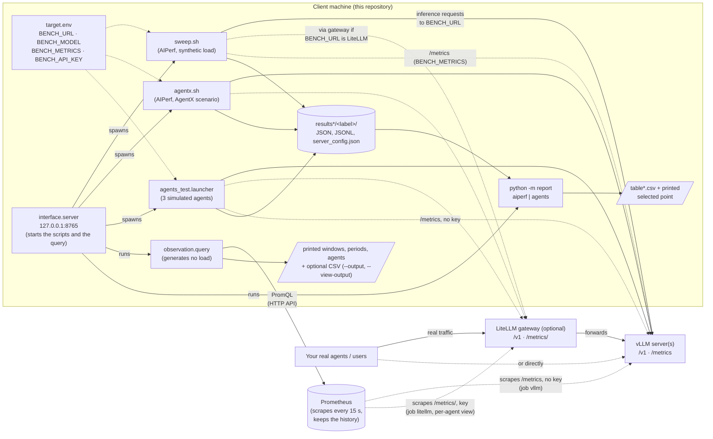

# banc-gpu
<a id="top"></a>

*Banc* is the French word for bench; the repository keeps the name `banc-gpu` so that its URL stays stable.

A capacity benchmark for a model served by vLLM: for a given installation, how many simultaneous
requests (or agent tasks) it sustains, and at what throughput per GPU, as long as each request receives
its tokens at a target speed (the **interactivity**, in tokens/s per request).

Two families of measurements:

- **stress tests**: the bench generates the load itself, in increasing levels, until the installation breaks;
  they give the installation's **capacity**;
- **observation**: the bench generates nothing and has nothing to start; Prometheus continuously collects the
  metrics of vLLM (and of LiteLLM) while your real agents run, and the bench queries it to tell you whether the
  installation **sustains the real load**, per window, per period and per agent, over any past range.

> **Status.** Written from the code of **vLLM at commit [`7f855f6`](https://github.com/vllm-project/vllm/tree/7f855f605892656ebf7265642e5d22a34a6ae731)**
> and tested with **AIPerf 0.13.0** against a fake server ([Appendix E](#appendix-e-try-the-bench-without-a-gpu)).
> Against a real vLLM it has only been tried on a small local server (vLLM 0.33.0), **not yet on a GPU server**.
> On your first real run, compare your outputs with the example in [section 5.4](#54-test-the-connection).
> Unfamiliar terms: see [Appendix G](#appendix-g-glossary). What is verified, documented or still unchecked is
> listed in [Appendix F](#appendix-f-validation-status).

## Contents

- [1. Choose a mode](#1-choose-a-mode)
- [2. Quick start](#2-quick-start)
  - [2.1 Get the code and install the dependencies](#21-get-the-code-and-install-the-dependencies)
  - [2.2 Point the bench at your vLLM](#22-point-the-bench-at-your-vllm)
  - [2.3 Check that it can reach the server](#23-check-that-it-can-reach-the-server)
  - [2.4 Run a first measurement and read it](#24-run-a-first-measurement-and-read-it)
- [3. How the pieces connect](#3-how-the-pieces-connect)
- [4. Requirements and installation](#4-requirements-and-installation)
  - [4.1 What must already be in place](#41-what-must-already-be-in-place)
  - [4.2 Check the vLLM in place](#42-check-the-vllm-in-place)
  - [4.3 Install the bench dependencies](#43-install-the-bench-dependencies)
- [5. Configure the client](#5-configure-the-client)
  - [5.1 Activate the environment](#51-activate-the-environment)
  - [5.2 Set the connection](#52-set-the-connection)
  - [5.3 Copy the tokenizer](#53-copy-the-tokenizer)
  - [5.4 Test the connection](#54-test-the-connection)
- [6. Stress tests](#6-stress-tests)
  - [6.1 Synthetic stress test](#61-synthetic-stress-test)
  - [6.2 Reading the AIPerf report (synthetic and AgentX)](#62-reading-the-aiperf-report-synthetic-and-agentx)
  - [6.3 AgentX stress test](#63-agentx-stress-test)
  - [6.4 AgentX without Internet access](#64-agentx-without-internet-access)
  - [6.5 AgentX with generated or your own traces](#65-agentx-with-generated-or-your-own-traces)
  - [6.6 Context shorter than the traces](#66-context-shorter-than-the-traces)
  - [6.7 Test-agents stress test](#67-test-agents-stress-test)
  - [6.8 Stress test through LiteLLM](#68-stress-test-through-litellm)
- [7. Observation (real use)](#7-observation-real-use)
  - [7.1 Tune vLLM for exact interactivity](#71-tune-vllm-for-exact-interactivity)
  - [7.2 Install and start Prometheus (once)](#72-install-and-start-prometheus-once)
  - [7.3 Query the observation](#73-query-the-observation)
  - [7.4 Per-period view](#74-per-period-view)
  - [7.5 Per-agent view through LiteLLM](#75-per-agent-view-through-litellm)
- [8. Measurement protocol](#8-measurement-protocol)
- [9. Interface](#9-interface)
- [10. Reference](#10-reference)
  - [10.1 Outputs on disk](#101-outputs-on-disk)
  - [10.2 Repository contents](#102-repository-contents)
  - [10.3 Troubleshooting](#103-troubleshooting)
- [Appendix A. Security notes](#appendix-a-security-notes)
- [Appendix B. LiteLLM per-key setup and install details](#appendix-b-litellm-per-key-setup-and-install-details)
- [Appendix C. Sources](#appendix-c-sources)
- [Appendix D. Tests](#appendix-d-tests)
- [Appendix E. Try the bench without a GPU](#appendix-e-try-the-bench-without-a-gpu)
  - [E.1 Start the fake server](#e1-start-the-fake-server)
  - [E.2 Run the test agents and read the report](#e2-run-the-test-agents-and-read-the-report)
  - [E.3 Try the observation](#e3-try-the-observation)
- [Appendix F. Validation status](#appendix-f-validation-status)
- [Appendix G. Glossary](#appendix-g-glossary)

---

## 1. Choose a mode

| Mode | Tool | Load | vLLM prefix cache | What it gives | Section |
|---|---|---|---|---|---|
| **Synthetic stress test** | `sweep.sh` (AIPerf) | fixed-length requests | **disabled** | conservative floor | [6.1](#61-synthetic-stress-test) |
| **AgentX stress test** | `agentx.sh` (AIPerf, scenario `inferencex-agentx-mvp`) | replayed coding-agent sessions (public, generated or yours) | enabled | with the public sessions, a measurement comparable to InferenceX's AgentX results | [6.3](#63-agentx-stress-test) |
| **Test-agents stress test** | `agents_test/` | three simulated agent profiles | enabled | agent load close to your usage | [6.7](#67-test-agents-stress-test) |
| **Observation** | `observation/query.py` + Prometheus | your agents, in real use | as configured | "does it hold?", per window, period, agent | [7](#7-observation-real-use) |

The stress tests read vLLM's `/metrics` themselves while they run; only observation needs Prometheus, because it analyses past activity.

**Start with the synthetic stress test**: it needs no trace download and is the quickest way to validate your setup.
Use observation instead if you already have agents running in production (it needs a Prometheus, [section 7.2](#72-install-and-start-prometheus-once)). Changing the prefix cache
requires restarting vLLM (see [section 4.2](#42-check-the-vllm-in-place)).

[↑ Back to top](#top)

---

## 2. Quick start

A first synthetic measurement, on a vLLM that is already running. You need [uv](https://docs.astral.sh/uv/), which
installs the right Python for the bench ([how to install it](#43-install-the-bench-dependencies)).

### 2.1 Get the code and install the dependencies

```bash
git clone https://github.com/Shevehs/banc-gpu.git ~/banc-gpu && cd ~/banc-gpu
uv venv --seed --python 3.12 .venv-aiperf && source .venv-aiperf/bin/activate
pip install aiperf==0.13.0 "openai>=1.40" httpx
```

### 2.2 Point the bench at your vLLM

Copy the example file, then edit `target.env`: set `BENCH_URL`, `BENCH_MODEL` and `BENCH_API_KEY`, and also
`BENCH_METRICS` if `BENCH_URL` is a LiteLLM gateway (see [section 5.2](#52-set-the-connection)).

```bash
cp tools/target.env.example target.env
source target.env
```

### 2.3 Check that it can reach the server

Download the tokenizer of your model, then read the server's configuration. The second command must print `[config]`
lines ([section 5.4](#54-test-the-connection)).

```bash
./tools/download_tokenizer.sh <Hugging Face repository of your model>
python tools/server_config.py --url "$BENCH_URL" --model "$BENCH_MODEL" --metrics "$BENCH_METRICS" > /dev/null
```

### 2.4 Run a first measurement and read it

vLLM must already serve the model with `--no-enable-prefix-caching` for this run
(see [section 4.2](#42-check-the-vllm-in-place)). The first command sends load at 1, 4 and 16 simultaneous requests; the
second one builds the report. The number of GPUs is deduced from the server's configuration; add `--gpu N` to force it.

```bash
./sweep.sh first-r1 "1 4 16"
python -m report aiperf results --target 30
```

The report prints one line per level, then the selected point. This is a real output, from a small test on a small server
(your figures will differ):

```
run                conc   tput/GPU  inter P10  TTFT P95 ms  preempt  err  cache   MTP  output avg
first-r1              1       23.8       39.7         4492        0    0      —     —         256
first-r1              4       31.7       11.2        18569        0    0      —     —         256
first-r1             16       37.2        2.6        49735        0    0      —     —         256

first: selected point = concurrency 1, 23.8 tokens/s per GPU (median of 1 repetition(s), from 23.8 to 23.8).
   Estimate at exactly 30.0 tokens/s (interpolation between concurrencies 1 and 4): 26.5 tokens/s per GPU. To be confirmed with an intermediate level.
```

How to read it:

- **`conc`** is the level: the number of requests in flight at the same time.
- **`tput/GPU`** is the total output speed (tokens/s) divided by the number of GPUs.
- **`inter P10`** is the speed each request receives, in tokens/s: 90% of the requests get at least this much. It is
  the figure compared with `--target`.
- **`TTFT P95 ms`** is the wait before the first token: 95% of the requests wait less than this.
- **`preempt`** and **`err`** (preempted and failed requests) must be 0 for a level to be accepted.
- **`cache`** and **`MTP`** show "—" when the prefix cache is off and there is no speculative decoding, as here.
- **Selected point**: the level with the highest throughput that still reaches the target without error or
  preemption. Here the target is 30 tokens/s: level 1 gets 39.7, level 4 only 11.2, so level 1 is selected.
- **Estimate**: the limit lies between level 1 and level 4, so the report estimates the throughput exactly at the
  target. Confirm it by running the levels in between (for example `"2 3"`).

Details: [section 6.2](#62-reading-the-aiperf-report-synthetic-and-agentx).

Unfamiliar terms: see [Appendix G](#appendix-g-glossary). No GPU at hand? Check the scripts first with the fake server ([Appendix E](#appendix-e-try-the-bench-without-a-gpu)).

Next steps: the other stress tests ([section 6](#6-stress-tests)), observation of your real agents
([section 7](#7-observation-real-use)), or the local interface ([section 9](#9-interface)).

[↑ Back to top](#top)

---

## 3. How the pieces connect



Solid arrows are traffic and file writes; dashed arrows are optional paths or metric reads.

Observation sends no load and starts nothing. Prometheus (a separate server) scrapes vLLM's `/metrics` (and LiteLLM's)
and keeps the history, and `observation.query` only queries it.

When the target is the LiteLLM gateway, `BENCH_METRICS` must list vLLM's `/metrics` URLs, because the gateway does not
expose them. A launch warning says so if it points elsewhere.

[↑ Back to top](#top)

---

## 4. Requirements and installation

### 4.1 What must already be in place

| Requirement | Detail | Check |
|---|---|---|
| **vLLM installed and the model served** | OpenAI-compatible API on `http://<host>:<port>`. The bench does not start vLLM. | `curl -s http://<host>:8000/v1/models` lists the model |
| **vLLM's `/metrics` reachable** from the client machine | Enabled by default; it provides preemptions, cache, speculative decoding, KV cache occupancy. It does **not** require the API key (see [Appendix A](#appendix-a-security-notes)). | `curl -s http://<host>:8000/metrics \| grep -c '^vllm:'` prints a number greater than 0 |
| **LiteLLM installed** (optional) | To measure through the gateway, or to follow the agents separately in observation ([section 7.5](#75-per-agent-view-through-litellm)): LiteLLM sees which agent sends each request, vLLM does not. Your vLLM declared as a model of LiteLLM, with its key if it has one ([LiteLLM, vLLM](https://docs.litellm.ai/docs/providers/vllm); [configuration](https://docs.litellm.ai/docs/proxy/configs)). | `curl -s -H "Authorization: Bearer <key>" http://<vm>:4000/v1/models` |
| **Prometheus** (observation only) | A separate server that scrapes vLLM's `/metrics` (and LiteLLM's) and keeps the history; vLLM does not provide one. A single binary ([download](https://prometheus.io/download/)), or the `prom/prometheus` Docker image. Configuration provided: `tools/prometheus.yml.example` ([section 7.2](#72-install-and-start-prometheus-once)). | `curl -s http://<host>:9090/-/ready` |
| **uv** on the client machine | Installs the Python that AIPerf 0.13 requires (3.11 to 3.13) for the bench's environment; see [section 4.3](#43-install-the-bench-dependencies). | `uv --version` |
| **bash** | Tested with bash 5; written to also run on the old bash 3.2, verified only with a bash 3.2 built on Linux. | `bash --version` |
| **Network** | The client machine reaches vLLM (and LiteLLM). No Internet access is needed once the tokenizer is copied into `tools/tokenizer/` ([section 5.3](#53-copy-the-tokenizer)). | — |

The **client machine** is the one that runs the measurements: the same machine as vLLM for a local trial, or
a VM on the same private network as the GPU servers. Do not run the clients on the servers being measured.

### 4.2 Check the vLLM in place

The bench never starts vLLM: it measures the one that runs. But the way that vLLM was launched changes the meaning of
some measurements. Before each mode, check its options; the connection test ([section 5.4](#54-test-the-connection))
prints the prefix cache, the version and the parallelism of the vLLM in place.

In practice:

- **Observation**: nothing to change; `--custom-histogram-buckets` only makes the share at the exact target available
  (otherwise interpolated), to be added at the next planned restart.
- **AgentX, test agents**: the production vLLM is usually fine (prefix cache enabled, the default); check
  `--max-model-len` and `--max-num-seqs` below.
- **Synthetic**: the only mode that asks for a dedicated **restart**, with `--no-enable-prefix-caching`; otherwise
  the measured throughput is inflated by the cache. So not on a production server in service.

**Options that matter to the bench**

- `--served-model-name <name>` (recommended): the short name you give the bench as `BENCH_MODEL`.
- **Prefix caching**, by mode:
  - **Synthetic stress test**: pass `--no-enable-prefix-caching`. AIPerf reuses its synthetic prompts, so the cache
    would inflate throughput.
  - **AgentX and test agents**: do **not** pass it. Agents re-read their context, so the cache is part of what is
    measured.
  - **Observation**: keep your production setting.

  Changing it requires **restarting vLLM** between the synthetic load and the other modes.
- `--max-model-len`: large enough for the mode (table below). The bench does not truncate.
  - A request whose input is longer is refused by vLLM and counted as an error.
  - If only the output does not fit, vLLM shortens it and the report shows a warning
    ([section 6.6](#66-context-shorter-than-the-traces)).
- `--max-num-seqs`: at least the highest concurrency, otherwise the extra requests wait.
  - AgentX: at least sessions x parallel sub-agents (inferred; keep a margin).
  - Test agents: at least the highest level x 3 (`code_review` launches 3 sub-agents).
- `--max-num-batched-tokens`: the number of tokens vLLM processes in one step. Keep your production value, so that
  the measurement represents it, and note it with the result: it moves the TTFT and the interactivity in opposite
  directions.
  - **Synthetic test**: when the value is close to the size of the prompts (2,048 tokens), the prompts are prefilled
    almost one at a time and the others wait in the queue.
    - It shows as waiting requests (`vllm:num_requests_waiting`) and as a long TTFT at high concurrency.
    - To tell this cause from a lack of memory, look at the KV cache and the preemptions. If the cache is not full and
      there is no preemption, the queue comes from this limit. If the cache is full or there are preemptions, memory
      is the limit.
    - A larger value usually lets several prompts through together on a GPU server. On a machine where prefill is
      already compute-bound, it changes little.
  - **AgentX and test agents**: the prompts are very long (a median of about 142,000 tokens for AgentX). vLLM splits
    them into chunks of at most this size, one chunk per step, mixed with the steps of the requests already
    generating.
    - A small value keeps each step short, so the running requests keep a steady rhythm (better interactivity), but a
      long prompt needs many steps (longer TTFT).
    - A large value prefills faster but makes each step longer, which shows as pauses between tokens for the other
      requests.
    - This is the usual trade-off, not measured here.

| Mode | `--max-model-len` at least | Why |
|---|---|---|
| Synthetic | input + output + chat template (e.g. 2,048 + 256, plus a margin) | requests have a fixed length |
| AgentX | the longest trace context, input **plus output**: up to about 990,000 input tokens (full set), 256,000 (`256k` variant), plus the output and a margin for the chat template; otherwise set `BENCH_MAX_CONTEXT` ([section 6.6](#66-context-shorter-than-the-traces)) | AIPerf does not truncate AgentX traces |
| AgentX, generated or your own traces | the longest call of your traces, input **plus output**, plus a margin for the chat template | you choose the sizes; `make_traces.py` prints the value for a generated set ([section 6.5](#65-agentx-with-generated-or-your-own-traces)) |
| Test agents | about 135,000 x `--scale`, plus the output | contexts reach about 135,000 tokens at scale 1 (estimated with the Qwen vocabulary) |
| Observation | not applicable | the bench sends nothing |

**Optional options**

| `vllm serve` option | Used by | Why |
|---|---|---|
| `--enable-prompt-tokens-details` | test agents (recommended) | each response reports the tokens read from cache |
| `--enable-auto-tool-choice --tool-call-parser <parser>` | test agents, `autonomous` mode only | tool calls chosen by the model |
| `--custom-histogram-buckets '…'` | observation (recommended at the next restart) | histogram bounds at your targets, for exact interactivity ([section 7.1](#71-tune-vllm-for-exact-interactivity)) |
| `--api-key <key>` | any mode | key to give the bench (`BENCH_API_KEY`); it does not protect everything, see [Appendix A](#appendix-a-security-notes) |
| `--fingerprint-mode` | any mode (keep the default `full`) | the bench reads the parallelism (TP, PP, DP, EP) from the responses' fingerprint; in `hash` mode it is hidden |

### 4.3 Install the bench dependencies

On the client machine, with [uv](https://docs.astral.sh/uv/): it downloads the Python that AIPerf needs (3.12) for this
environment only, so you do not have to install or upgrade Python yourself.

Install uv if you do not have it (other ways in the
[uv documentation](https://docs.astral.sh/uv/getting-started/installation/)):

```bash
curl -LsSf https://astral.sh/uv/install.sh | sh
```

Get the code:

```bash
git clone https://github.com/Shevehs/banc-gpu.git ~/banc-gpu && cd ~/banc-gpu
```

Create the environment (`--seed` puts pip in it) and install the dependencies in it (AIPerf and the Python libraries the bench uses):

```bash
uv venv --seed --python 3.12 .venv-aiperf
source .venv-aiperf/bin/activate
pip install aiperf==0.13.0 "openai>=1.40" httpx
```

`sweep.sh` and `agentx.sh` check the AIPerf version and stop with a message if it is older than 0.13.

Check the installation:

```bash
aiperf --version && python -c "import openai, aiohttp; print('ok')"
```

AIPerf also installs `aiohttp` (interface) and the `hf` command (tokenizer). Without Internet access, `pip` and `uv`
(which downloads Python) must point to a mirror.

[↑ Back to top](#top)

---

## 5. Configure the client

### 5.1 Activate the environment

In each new terminal:

```bash
cd ~/banc-gpu && source .venv-aiperf/bin/activate
```

### 5.2 Set the connection

```bash
cp tools/target.env.example target.env     # target.env is ignored by git: it contains the key
```

Fill in `target.env` (keep the `export`s), then load it in each new terminal: `source target.env`.
The interface ([section 9](#9-interface)) also reads this file when it starts, so it does not need the `source`.

**Why `BENCH_METRICS` must point to vLLM**

The stress tests read the state of the engine at this address, and only vLLM knows it. If `BENCH_METRICS` holds
LiteLLM's metrics, or nothing, these are lost:

- the **preemptions** (a level where vLLM runs out of memory can then be kept as healthy);
- the maximum KV cache usage;
- the engine's queue;
- the prefix cache;
- the acceptance of speculative decoding.

The matching columns stay empty. Throughput, interactivity, TTFT and errors are measured at the client, so they remain
valid.

At the start of each run, a `[config] WARNING: … is not vLLM's /metrics` line flags the mistake. In that case LiteLLM
answers "HTTP 401: key required", or there is no `vllm:` metric at all.

| Variable | Meaning | Example |
|---|---|---|
| `BENCH_URL` | **target** of the requests: vLLM directly (GPU measurement) or LiteLLM (measurement through the gateway) | `http://10.0.0.5:8000` |
| `BENCH_MODEL` | name served by vLLM (`--served-model-name`) or LiteLLM alias. `sweep.sh` and `agentx.sh` stop if the server does not know it | `bench` |
| `BENCH_METRICS` | `/metrics` address **of vLLM** (never LiteLLM's or Prometheus'), one per replica, separated by spaces. Empty = `BENCH_URL/metrics`, which only suits a `BENCH_URL` that points to vLLM directly. If `BENCH_URL` points to LiteLLM, give vLLM's address | `http://10.0.0.5:8000/metrics` |
| `BENCH_API_KEY` | the target's key (vLLM's `--api-key`, or a LiteLLM key). Sent to the target only; it is not written to the bench's logs, but see [Appendix A](#appendix-a-security-notes) (visible in `ps` while AIPerf runs) | — |
| `BENCH_TOKENIZER` | empty = `tools/tokenizer/` ([section 5.3](#53-copy-the-tokenizer)); otherwise the absolute path of a folder that holds `tokenizer.json` (no copy), or a Hugging Face name (AIPerf downloads it; the test agents, which only read a local folder, then estimate the sizes) | empty |

Settings are read from the `BENCH_*` variables.

**In a company only** (on a local workstation, nothing to do):

- **Proxy**: if `HTTP_PROXY` or `HTTPS_PROXY` are set, the bench ignores them and reaches the servers directly, like
  AIPerf: its API key does not leave the private network through the proxy, and the measurement does not include the
  proxy's latency. If the client machine can reach the servers **only** through a proxy (rare on a private network),
  the bench will not work as is.
- **Internal certificate**: if the target is `https://` with a certificate signed by the company's certificate
  authority, give the file of that authority: `export SSL_CERT_FILE=/path/ca.pem` (read by AIPerf, the scripts and the
  test agents).

Do not put `HF_HUB_OFFLINE=1` in this file: with a local tokenizer, AIPerf fails when this
variable is set (`sweep.sh` removes it for AIPerf anyway).

### 5.3 Copy the tokenizer

AIPerf needs the tokenizer of the measured model to build prompts of the right length; the agents use it to adjust
their sizes. On a machine with Hugging Face access:

```bash
./tools/download_tokenizer.sh <model's Hugging Face repository>   # puts the files in tools/tokenizer/
ls tools/tokenizer/tokenizer.json
```

Without Hugging Face access, copy `tokenizer.json` and `tokenizer_config.json` from the weights folder into
`tools/tokenizer/`.

**Without a copy**: set in `target.env` the folder that already holds `tokenizer.json`, for example the one vLLM
downloaded. Give the absolute path of the folder, not of the file, and the one of the model actually served:

```bash
export BENCH_TOKENIZER=$HOME/.cache/huggingface/hub/models--<organization>--<model>/snapshots/<hash>
```

Check the model's license before versioning these files.

### 5.4 Test the connection

```bash
curl -s -H "Authorization: Bearer $BENCH_API_KEY" "$BENCH_URL/v1/models"
python tools/server_config.py --url "$BENCH_URL" --model "$BENCH_MODEL" --metrics "$BENCH_METRICS" > /dev/null
```

**You should see** the model, then `[config]` lines. The exact wording is set by `tools/server_config.py`.

The `[config]` lines give:

- the fingerprint (vLLM version, decoded TP / PP / DP / EP), from the target or, when the target is a gateway that
  does not pass it on, from the first vLLM server of `BENCH_METRICS`;
- the number of GPUs deduced from it;
- then, for each `/metrics` URL: the vLLM version, whether the prefix cache is on, and the number of speculative
  tokens read from the metrics (0 = no speculative decoding).

Example for a TP 8 server with expert parallelism and 3 speculative tokens:

```
[config] target fingerprint: vllm-<version>-tp8-ep-<hash> -> TP 8, PP 1, DP 1, EP yes
[config] GPUs deduced: 8 (TP 8 × PP 1 × DP 1 × 1 vLLM server(s))
[config] http://10.0.0.5:8000/metrics : vLLM <version>; prefix cache False; speculative tokens (metrics) 3; /server_info absent or not read (VLLM_SERVER_DEV_MODE not enabled?)
```

Through a gateway, the first word of the fingerprint line is `vLLM` instead of `target`: the fingerprint was read from vLLM.

Check that the **prefix cache** and the **parallelism** are those of the measurement you are about to make.

The GPU count is the TP x PP x DP of the fingerprint, times the number of vLLM servers recognised in `BENCH_METRICS`
(all assumed identical to the one that answered). The reports reuse it when `--gpu` is not given
([section 6.2](#62-reading-the-aiperf-report-synthetic-and-agentx)).

**If something looks wrong**, these are the usual messages and what to do:

- **`[config] ERROR: the server does not know the model …`**: the name in `BENCH_MODEL` is not one the server
  serves. It is `bench` when the variable is not set. Set `BENCH_MODEL` to a name the server serves. The message lists
  them when the server can say; otherwise read `/v1/models` with the first command above.
- **The same error at the start of `sweep.sh` or `agentx.sh`**: both scripts make this check themselves. They stop
  before any measurement, with nothing created. Only a clear refusal of the name stops them: an unreachable server or
  a refused key does not.
- **`[config] WARNING: … is not vLLM's /metrics`**: the address in `BENCH_METRICS` is not vLLM's. Either it points to
  LiteLLM, which answers "HTTP 401: key required", or it exposes no `vllm:` metric at all. Put vLLM's `/metrics`
  address in `BENCH_METRICS` ([section 5.2](#52-set-the-connection)).
- **No fingerprint, and the output says the server did not respond**: the key or the target is wrong, or the model
  name (the `ERROR` line above names it when the server refuses it). Fix it before going on.
- **No fingerprint and no other message**: the vLLM version does not produce it, `--fingerprint-mode none` is set, or
  the target is a gateway that drops the field and vLLM could not be asked. vLLM is asked directly (one token, with
  the model it lists, and no key) when `BENCH_METRICS` points at it; if vLLM has its own `--api-key`, target vLLM
  directly, or note the launch command with your results.
- **"TP 1, PP 1, DP 1, EP no (or hidden…)"**: this is true for a server without parallelism, but it is also what a
  server launched with `--fingerprint-mode hash` shows. Check the launch command.

More cases are in the troubleshooting table ([section 10.3](#103-troubleshooting)).

[↑ Back to top](#top)

---

## 6. Stress tests

The bench generates the load, level by level, until the installation breaks. The prefix-cache setting
required by each test is in [section 4.2](#42-check-the-vllm-in-place). A **label** names each run; the suffix `-r1`, `-r2`…
marks repetitions of the same configuration, which the report groups together. To repeat a run, launch the same
command again with the next label (`-r2`, `-r3`): there is no setting for a number of repetitions. A label has up to
80 characters: letters, digits, dots, hyphens and underscores, starting with a letter or a digit and without two dots
in a row (`..`).

### 6.1 Synthetic stress test

This test uses **AIPerf** (through `sweep.sh`) to send requests of a fixed length, one level of concurrency after the
other (2,048 input and 256 output tokens by default).

vLLM must be launched **with** `--no-enable-prefix-caching`.

```bash
./sweep.sh trial-r1 "1 2 4 8 16 32 64"
```

- One **label** per run (`trial-r1`). A label already used is refused (`BENCH_OVERWRITE=1` replaces it).
- A list of **concurrencies**: one level per value.
- Settings by variables, in front of the command:

| Variable | Default | Meaning |
|---|---|---|
| `BENCH_ISL` / `BENCH_OSL` | 2048 / 256 | input / output tokens per request (output enforced: `min_tokens` + `ignore_eos`) |
| `BENCH_DURATION` | empty | seconds per level; empty = a fixed number of requests per level (next row) |
| `BENCH_REQUESTS_PER_CONCURRENCY` | 8 | without `BENCH_DURATION`: requests per level = this value x the concurrency, at least 16 |
| `BENCH_ROOT_DIR` | `results` | results folder |
| `BENCH_SEED` | hash of the label | random seed; each label (so each repetition) gets a different one unless you set it |
| `BENCH_TEMPERATURE` | 0.7 | fixed so that speculative decoding is comparable from one run to the next |
| `BENCH_EXTRA` | empty | additional AIPerf options, e.g. `--use-server-token-count` |

**How a level is sized.** The concurrency is the number of requests in flight at the same time. The number of requests
of a level is the total sent before it ends.

Take a concurrency of 4: the bench keeps 4 requests open, and as soon as one finishes it sends the next, until 32
requests (4 x 8) have completed. Each of the 4 slots has then handled 8 requests one after the other.

The load never exceeds 4 requests at once; `BENCH_REQUESTS_PER_CONCURRENCY` only sets how long it is held. This matters
for two reasons:

- **A steady load.** At the start of a level all the slots send their request together, and at the end the last
  requests finish while the other slots are already empty. With about 8 requests per slot, the middle part, where the
  full concurrency is in flight, dominates the measurement. A fixed total for every level would leave the high levels
  with one request or two per slot, which mostly measures the start-up.
- **Enough requests for the percentiles.** The P10 interactivity and the P95 TTFT are computed over all the requests of
  the level, so more requests make them steadier. The minimum of 16 keeps the lowest levels from having too few.

The cost is that the duration of a level depends on the speed of the server, and a low level rests on few requests, so
its percentiles are rough. To confirm a selected level, or for a reference measurement, set `BENCH_DURATION` instead:
every level then lasts that many seconds, with many more requests per level.

Each level starts with a warm-up of as many requests as its concurrency. They are not part of the results.

Example for a reference measurement: `BENCH_ISL=32768 BENCH_OSL=512 BENCH_DURATION=900 ./sweep.sh conf-a-r1 "48 52 56 60 64"`.

**You should see** one line per level with its duration, then a completion message. Failed requests do not stop
AIPerf: check the `err` column in the report ([section 6.2](#62-reading-the-aiperf-report-synthetic-and-agentx)).

### 6.2 Reading the AIPerf report (synthetic and AgentX)

This report reads the AIPerf results: the synthetic stress test (`sweep.sh`) and the AgentX stress test
(`agentx.sh`). The test agents have their own report ([section 6.7](#67-test-agents-stress-test)).

```bash
python -m report aiperf results --target 30
```

Options:

- `--target`: target interactivity, in tokens/s per request.
- `--gpu`: number of GPUs behind the target, all replicas included. Optional, see below.
- `--require-metrics`: rejects a level without server metrics.
- `--ttft-max <ms>`: rejects a level whose P95 TTFT exceeds this threshold. It exists in this report only;
  `observation.query` has its own `--ttft-max` ([section 7.3](#73-query-the-observation)).

**About `--gpu`.** Without it, the report deduces the count from the `server_config.json` of each run: TP x PP x DP read
from the fingerprint, times the number of vLLM servers recognised in `BENCH_METRICS`. It prints the result, for example:

```
GPUs: <run>: 8 (TP 8 × PP 1 × DP 1 × 1 vLLM server(s)), deduced from the fingerprint
```

A WARNING flags repetitions of one configuration with different counts. If you give `--gpu`, it prevails, and a WARNING
says so if it contradicts the fingerprint.

**Give `--gpu` yourself when:**

- the fingerprint is missing (the report then stops with an error and the reason);
- the fingerprint carries no parallelism degree while the server has several GPUs (`--fingerprint-mode hash` hides
  them; a WARNING says so, and with a single GPU this warning is expected);
- the replicas differ;
- you use prefill context parallelism (PCP), which is absent from the fingerprint and read only when `/server_info`
  exists;
- you run a data-parallel deployment split into one API server per rank: each fingerprint carries the global DP, so the
  deduced count would be too high (inferred).

The columns of the table:

| Column | Meaning |
|---|---|
| conc | the level: number of requests (sessions for AgentX) in flight at the same time |
| tput/GPU | output tokens per second, all requests combined, ÷ number of GPUs |
| inter P10 | interactivity at the 10th percentile: 90% of requests wrote at least at this speed |
| TTFT P95 ms | wait before the first token, 95th percentile |
| preempt | requests suspended for lack of memory; must be 0 |
| err | failed requests; must be 0 |
| cache | share of input tokens found in the prefix cache; "—" or about 0 for the synthetic load (cache disabled) |
| MTP | speculative-decoding acceptance rate; "—" without speculative decoding |
| output avg | average output tokens per request; must equal `BENCH_OSL` (varies from trace to trace for AgentX) |

Then the **selected point**: the level with the highest throughput that meets the target, with no errors or
preemptions (median of the repetitions), and an **estimate interpolated exactly at the target**.

Read the warnings: "highest level tested" means you need to add levels above it.

The full table is in `results/table.csv` (`results-agentx/table.csv` for AgentX).

### 6.3 AgentX stress test

This test uses **AIPerf** (through `agentx.sh`) to replay the coding-agent sessions (Claude Code, sub-agents included)
published by SemiAnalysis, with AIPerf's locked scenario `inferencex-agentx-mvp`, the one behind InferenceX's AgentX
measurements ([method](https://inferencex.semianalysis.com/blog/agentic-benchmark-agent-benchmark-guide)).

The result is therefore comparable to the published AgentX exports: same traces, same scenario, but a different engine
and hardware.

Contexts are long (a median of about 142,000 input tokens, according to
[InferenceX](https://inferencex.semianalysis.com/blog/agentic-benchmark-agent-benchmark-guide)) and are not truncated.
The full measurement is therefore done on GPU servers.

On a small server whose context is limited to 32,768 tokens, no trace of the published set fits
([section 6.6](#66-context-shorter-than-the-traces)). You can generate shorter traces, or use your own
([section 6.5](#65-agentx-with-generated-or-your-own-traces)).

**What the scenario enforces** (documented in the AIPerf 0.13.0 code,
`aiperf/common/scenario/inferencex_agentx_mvp.py`, and in AIPerf's message at run time):

- streaming;
- output at the trace's length (`ignore_eos`, added automatically);
- **at least 900 s per level** (1,800 by default);
- no truncation of inputs;
- delays between turns replayed;
- first-turn prefix scrambled, so that a run does not benefit from the previous run's cache;
- the trace set is one of the published versions that AIPerf accepts (the bench uses `semianalysisai/cc-traces-weka-062126`,
  the most recent in AIPerf 0.13.0). A run on another set, or on a local copy AIPerf cannot check, is marked
  `submission_valid=false` and is not comparable.

The traces are published on Hugging Face. By default, `agentx.sh` **downloads them itself** on the first run (about
1.85 GB, Internet access required), and the run is marked valid. Without Internet access, see
[section 6.4](#64-agentx-without-internet-access).

vLLM must be launched with the prefix cache **enabled**: the traces carry the cache block fingerprints, to reproduce
their reuse. Then:

```bash
BENCH_DURATION=1800 ./agentx.sh agentx-r1 "1 2 4 8"
python -m report aiperf results-agentx --target 30
```

| Variable | Default | Meaning |
|---|---|---|
| `BENCH_DURATION` | 1800 | seconds per level; at least 900 |
| `BENCH_AGENTX_DIR` | empty | local traces folder: the offline copy ([section 6.4](#64-agentx-without-internet-access)), a generated set or your own traces ([section 6.5](#65-agentx-with-generated-or-your-own-traces)) |
| `BENCH_AGENTX_VARIANT` | empty | empty = the full set; `256k` = the set without the requests above 256,000 tokens |
| `BENCH_ROOT_DIR` | `results-agentx` | results folder |
| `BENCH_SEED` | hash of the label | seed of the random choices (where each trace starts); each label gets a different one unless you set it |
| `BENCH_OVERWRITE` | empty | `1` = replace a run that has the same label |
| `BENCH_SHORT_RUN` | empty | `1` = levels shorter than 900 s, to check the pipeline only (not comparable) |
| `BENCH_MAX_CONTEXT` | empty | tokens; AIPerf discards traces whose peak context exceeds this value (`--max-context-length`) |
| `AIPERF_DATASET_CONFIGURATION_TIMEOUT` | 1800 | seconds allowed for loading the traces |
| `AIPERF_DATASET_WEKA_PARALLEL_WORKERS` | 1 with a local tokenizer folder (outside Linux), otherwise AIPerf's own choice | number of processes that load the traces; 1 = a single process |

Notes on these variables:

- **`BENCH_AGENTX_DIR`**: with a local folder, the run is marked `submission_valid=false`, because AIPerf cannot verify
  the set.
- **`BENCH_AGENTX_VARIANT=256k`**: this is the set `…-062126-256k`, where SemiAnalysis removed the requests above
  256,000 tokens. Use it for a `--max-model-len` of about 256,000. The scenario accepts it. This comes from the dataset
  description in AIPerf (`plugins.yaml`).
- **`AIPERF_DATASET_CONFIGURATION_TIMEOUT`**: AIPerf's default is 300 s, too short for the 393 traces.
  `AIPERF_SERVICE_PROFILE_CONFIGURE_TIMEOUT` is raised to at least this value, as AIPerf requires.
- **`AIPERF_DATASET_WEKA_PARALLEL_WORKERS`**: with a local tokenizer folder, `agentx.sh` sets it to 1 (outside Linux),
  because AIPerf's loading processes cannot use a folder ([section 6.5](#65-agentx-with-generated-or-your-own-traces)). A value set in the
  terminal is kept. Loading in a single process is slower than in parallel for a large set; this was not measured.

The levels are numbers of **sessions replayed at the same time** (AIPerf's `--concurrency`). The report is the one
described in [section 6.2](#62-reading-the-aiperf-report-synthetic-and-agentx).

**Which traces are replayed** (AIPerf 0.13.0):

- A trace is one whole agent session, made of many requests.
- AIPerf takes the traces one after the other, in the order of the set (after the filter of
  [section 6.6](#66-context-shorter-than-the-traces), if you use one), and starts again from the first at the end.
- A level stops on time, not when every trace has been played: a short level may replay only a few of them.
- The replay of a trace starts at a random point of it (it can be anywhere, from the start to the end of the trace).
  `BENCH_SEED` fixes these starting points (the order does not depend on it). Unless you set `BENCH_SEED`, each label
  has its own seed: the repetitions `-r1`, `-r2`… do not start at the same points.

Duration: one test of 5 levels x 30 min takes about 2 h 30 (about 1 h 15 at 15 min per level). The measurement protocol ([section 8](#8-measurement-protocol)) recommends three repetitions, which makes about 7 h 30 per configuration (about 3 h 45 at 15 min per level).

### 6.4 AgentX without Internet access

If the client machine has no Internet access, copy the traces. Do this once, on a machine with Hugging Face access
(where the traces are published):

```bash
./tools/download_agentx_traces.sh traces-agentx     # 393 traces, about 1.85 GB
```

Copy the folder to the client machine, then run `BENCH_AGENTX_DIR=traces-agentx ./agentx.sh …`.

The set is published under the Apache-2.0 license, according to its
[Hugging Face page](https://huggingface.co/datasets/semianalysisai/cc-traces-weka-062126). Check it before bringing it
into your environment.

Not verified: that the repository stores one trace per JSON file in a single folder (the script counts the files and
reports it).

### 6.5 AgentX with generated or your own traces

By default, AgentX replays the sessions published by SemiAnalysis. It can also replay a local folder of traces,
set with `BENCH_AGENTX_DIR` (the same variable as for the offline copy, [section 6.4](#64-agentx-without-internet-access)).

There are two ways to get such a folder:

- **Generate it.** A script writes synthetic sessions of the size you choose, so that the same test runs on a small
  server and on a large one.
- **Build it from your own agent's logs.** The test then replays your real usage.

[`tools/traces.md`](tools/traces.md) explains both, and the format of a trace.

**Generate a set**

This writes 30 sessions whose longest call is about 28,000 tokens (preset `small`):

```bash
python tools/make_traces.py --preset small --output traces-small
```

The interface does the same from the "Trace set" list of the AgentX launch ([section 9](#9-interface)):

- it writes `traces-<preset>` the first time and reuses the folder afterwards;
- it uses the default options (30 sessions, seed 1): for anything else, run the script yourself;
- to generate a set again, delete its folder.

The presets are `tiny`, `small`, `medium` and `large`: the longest call is 8,000, 28,000, 120,000 and 250,000 tokens.
The script prints the `--max-model-len` that vLLM needs for your set.

Replay the set:

```bash
BENCH_AGENTX_DIR=traces-small ./agentx.sh small-r1 "1 2 4"
```

`small-r1` is the label of the run and `"1 2 4"` are the levels. With the default duration of 1,800 s per level, this
run takes about 90 minutes.

Read the report:

```bash
python -m report aiperf results-agentx --target 30
```

**Build a set from your own logs**

No tool in this repository converts agent logs. [`tools/traces.md`](tools/traces.md) gives the conversion code for two
cases: logs that keep the prompts, and logs that keep only sizes.

The delicate part is the cache block IDs (`hash_ids`): identical prefixes must get identical IDs, otherwise the cache
reuse is not reproduced. The conversion code of `tools/traces.md` computes them from the prefixes. Then replay the folder with the same commands as above, with your own folder in
`BENCH_AGENTX_DIR`.

**Good to know**

- The run is marked `submission_valid=false`: AIPerf cannot verify a local set. The results are not comparable to the
  published AgentX ones, but they are comparable between your own runs.
- The other rules of the scenario still apply, such as at least 900 s per level.
- `--max-model-len` must cover the longest call of your traces ([section 6.6](#66-context-shorter-than-the-traces)).
- From 8 traces on, AIPerf loads the traces with several processes (a generated set has 30). Outside Linux, these
  processes cannot use a local tokenizer folder, and the run never starts.
- With a local folder (`tools/tokenizer/`, the default), `agentx.sh` therefore loads the traces in a single process by
  itself. With a Hugging Face name in `BENCH_TOKENIZER`, the loading stays parallel and needs the name in the
  Hugging Face cache. On Linux, nothing is changed ([details](tools/traces.md#good-to-know)).

**Check a folder first, without a GPU**

Start the fake server ([Appendix E](#appendix-e-try-the-bench-without-a-gpu)), then run a short check on your folder
(here `traces-small`). `BENCH_SHORT_RUN=1` allows a level shorter than 900 s:

```bash
BENCH_URL=http://127.0.0.1:8001 BENCH_MODEL=bench BENCH_API_KEY=x BENCH_AGENTX_DIR=traces-small \
  BENCH_SHORT_RUN=1 BENCH_DURATION=60 ./agentx.sh check-r1 "1"
```

**What was tried**

A generated set of 20 traces and a small hand-made folder were replayed against the fake server. AIPerf accepted both
folders, replayed the sessions and the report ran.

Not tried:
- a real vLLM with generated or hand-made traces;
- traces captured from a real agent;
- the exact definition of the hash IDs (AIPerf's loader points to the kv-cache-tester documentation, which has not
  been checked).

### 6.6 Context shorter than the traces

The scenario forbids truncating a trace, and AIPerf has no option to do so. It does accept discarding the traces that do
not fit, with AIPerf's `--max-context-length` (documented by its help; no scenario warning when tried).

This is useful on a GPU server whose `--max-model-len` is a little shorter than the longest traces:

```bash
BENCH_MAX_CONTEXT=129024 BENCH_DURATION=1800 ./agentx.sh agentx-128k-r1 "1 2 4 8"   # vLLM: --max-model-len 131072
```

The filter applies to the **maximum** context of each session.

**Not on a small server, with the published set**: at 30,720 tokens (vLLM at 32,768), none of the 393 traces fits
(observed during a trial on a small server: "No eligible traces … scanned 393"). AIPerf then stops before the first
level, and the script says so.

On a small server, use shorter traces: generated ones or your own
([section 6.5](#65-agentx-with-generated-or-your-own-traces)). The test agents also work there
([section 6.7](#67-test-agents-stress-test)). The published set is measured on GPU servers.

**Leave a margin** below `--max-model-len` (here 2,048 tokens). The filter compares the lengths recorded in the traces,
whereas the server also counts the chat template (roles, separators; inferred).

What happens when a request does not fit:

- If its **input** exceeds `--max-model-len`, vLLM refuses it. AIPerf removes it from its metrics, and the report counts
  it in `err` and rejects the level.
- If the input fits but not the output, vLLM does not refuse: it reduces `max_tokens` to the remaining room (documented
  by vLLM's code, `vllm/entrypoints/serve/utils/api_utils.py`, `get_max_tokens`). The report flags it with a WARNING
  (AIPerf's `osl_mismatch_count`, column `shortened_outputs`).

A run with `BENCH_MAX_CONTEXT` replays only the sessions that stay under the limit, so it leaves out the longest ones.
Its load is probably lighter than the full set (inferred), and the result is **not comparable** to the published
AgentX results.

Record how many traces were kept with your result. The level log, `results-agentx/<label>/c<N>.log`, has a line such as
`traces: scanned 393, rejected_by_maxctx 243 (--max-context-length=…), eligible 150`: it says that 150 of the 393 traces
were used.

### 6.7 Test-agents stress test

The test agents are three profiles (`code_review` with sub-agents, step-by-step `pentest`, `report`).
Their tools are simulated: they return fabricated text and act on no system.

Like `sweep.sh` and `agentx.sh`, the launcher reads the variables of `target.env`: load it in this terminal first
([section 5.2](#52-set-the-connection)). `BENCH_URL`, `BENCH_MODEL` and `BENCH_METRICS` are the defaults of `--url`,
`--model` and `--metrics`. An option typed on the command line wins over its variable. Two more rules:

- `BENCH_METRICS` goes with `BENCH_URL`: it is used only when `--url` is not given. A run aimed at another URL never
  reads the metrics of the server of `target.env`.
- If `BENCH_URL` is the LiteLLM gateway, set `BENCH_METRICS` to vLLM's `/metrics`
  ([section 5.2](#52-set-the-connection)), as for the other tests.

Without the variables, the defaults are `http://127.0.0.1:8000`, the model name `bench` and `<url>/metrics`.

Then check that `BENCH_MODEL` is a name the server serves ([section 5.4](#54-test-the-connection)). Unlike `sweep.sh`
and `agentx.sh`, the launcher does not check it, and the tasks would fail at once.

vLLM must run with the prefix cache enabled (without `--no-enable-prefix-caching`). If you have just run the synthetic
test, restart vLLM ([section 4.2](#42-check-the-vllm-in-place)). Check that the `[config]` line says `prefix cache True`
([section 5.4](#54-test-the-connection)), then start the test agents:

```bash
python -m agents_test.launcher --levels "1 2 4 8" --duration 900 --warmup 300 --scale 1 --label conf-a-r1
```

For a repetition, run the same command again with `--label conf-a-r2`, then `conf-a-r3`. `BENCH_SEED` does not apply to
the test agents: the launcher derives its random text from the label.

Then read the report:

```bash
python -m report agents results-agents --target 30
```

| Option | Meaning |
|---|---|
| `--url` | the target: vLLM or the LiteLLM gateway (default `BENCH_URL`, else `http://127.0.0.1:8000`) |
| `--model` | the served model name (default `BENCH_MODEL`, else `bench`) |
| `--metrics` | vLLM `/metrics` URLs, separated by spaces. Default: `BENCH_METRICS` if `--url` is not given, else `<url>/metrics`. It replaces the default, it does not add to it |
| `--levels` | numbers of simultaneous tasks; each level holds for `--duration` seconds, alternating the three profiles |
| `--warmup` | seconds excluded from the measurement at the start of a level (at least the duration of one task); must be < `--duration` |
| `--scale` | multiplies all sizes: 1 = contexts up to about 135,000 tokens; 0.2 for a small server with 32,768 tokens of context |
| `--agents` | subset of `code_review,pentest,report` |
| `--mode` | `scripted` (default, measurement: tools and lengths enforced) or `autonomous` (checks tool calling, does not measure: the model decides whether to call a tool, so an agent can stop early) |
| `--output` | results folder (default `results-agents`, relative to the current folder; runs started from the [interface](#9-interface) use `agents_test/results-agents`) |
| `--label-agents` | adds `metadata.agent` = profile name to each request (per-agent view through LiteLLM, [section 7.5](#75-per-agent-view-through-litellm)) |

Other options:

- `--spread`: staggers the workers' start over this many seconds
- `--latency-factor`: multiplies the simulated tool times (1 to measure)
- `--no-metrics`: does not read `/metrics`
- `--overwrite`: replaces existing results with the same label

The key has no option. The launcher reads `BENCH_API_KEY` from the environment, which `target.env` also sets.
`BENCH_AGENT_KEYS` gives one key per profile ([section 7.5](#75-per-agent-view-through-litellm)). Without a key, the
launcher sends the placeholder `bench`, which is fine for a vLLM started without `--api-key`.

The report gives an "all" row per level, then one row per profile (tasks, err, tput/GPU, inter P10, TTFT P95 in
seconds, cache share, task duration, preemptions, MTP, maximum KV cache), and the selected level. The full table is
`results-agents/table_agents.csv`. The report accepts `--require-metrics` but not `--ttft-max`.

For a run in `autonomous` mode, the report prints a `WARNING` when an agent made less than half the calls of its
profile. The model then stopped calling tools, and the contexts are shorter than the profile. Use `scripted` mode to
measure.

**To check**: the cache column should be clearly above 0 for `pentest` and `report`.

For a quick first check: `--levels "1 2" --duration 300 --warmup 60 --scale 0.2`.

### 6.8 Stress test through LiteLLM

A variant of the synthetic stress test ([section 6.1](#61-synthetic-stress-test)): the same sweep, aiming at LiteLLM and giving the URL of vLLM's metrics:

```bash
BENCH_URL=http://<vm>:4000 BENCH_MODEL=<alias> BENCH_API_KEY=<LiteLLM key> BENCH_METRICS=http://<host>:8000/metrics \
  ./sweep.sh conf-a-litellm-r1 "1 4 16"
```

Compare with the same sweep made directly on vLLM: the TTFT gap is the latency added by the gateway.
**Check** that the report's "output avg" column equals `BENCH_OSL`: otherwise LiteLLM does not forward `min_tokens` /
`ignore_eos` and the two measurements are not comparable (not verified).

Several replicas behind LiteLLM: `BENCH_METRICS` takes one URL per replica; the deduced GPU count adds them all
([section 6.2](#62-reading-the-aiperf-report-synthetic-and-agentx)), assuming they are identical to the one that answered.
Measure the replicas **together**, as they will serve.

[↑ Back to top](#top)

---

## 7. Observation (real use)

Your agents call vLLM, directly or through LiteLLM. The bench generates **no** request and has **nothing to start**.
The work is split as follows:

- **vLLM** exposes its counters on `/metrics`, cumulated since its start. It keeps no history
  ([vLLM metrics](https://docs.vllm.ai/en/latest/design/metrics.html)).
- **Prometheus**, a separate server, reads `/metrics` every 15 s and keeps the history
  ([overview](https://prometheus.io/docs/introduction/overview/)). It also reads LiteLLM's metrics for the per-agent
  view.
- **`observation/query.py`** (`python -m observation.query`, or the Observation tab of the [interface](#9-interface))
  queries Prometheus over a past range and cuts it into windows. Per window, it computes:
  - completed requests;
  - mean concurrency (requests in flight);
  - output throughput per GPU;
  - the **share of requests that sustain the target interactivity**;
  - TTFT, preemptions and failed requests;
  - prefix cache, MTP acceptance, KV cache and queue.

  It then gives a verdict.

A single read of `/metrics` would not be enough: its counters mix everything since the start. What is needed is the
difference between the start and the end of each window. `observation.query` asks Prometheus for it (value at the end
minus value at the start, [`offset`](https://prometheus.io/docs/prometheus/latest/querying/basics/#offset-modifier)).

Two kinds of window are discarded:

- A window in which the server restarted: its counters start again from zero, so the difference no longer means
  anything. A restart is detected with
  [`resets()`](https://prometheus.io/docs/prometheus/latest/querying/functions/#resets) and, when vLLM exposes it, with
  `process_start_time_seconds`.
- A window with no scrape just before its start (Prometheus stopped): `offset` would fetch a value up to 5 min earlier
  ([lookback](https://prometheus.io/docs/prometheus/latest/querying/basics/#staleness)) and the window would count the
  gap.

### 7.1 Tune vLLM for exact interactivity

Optional: nothing has to change on vLLM for observation, and a restart is not needed just for this. Add the option
below at the next planned restart; it only makes the share at the exact target available (otherwise interpolated).

Interactivity comes from the histogram `vllm:request_time_per_output_token_seconds`: the average time between two
tokens of each request, first token excluded
([`stats.py`](https://github.com/vllm-project/vllm/blob/7f855f605892656ebf7265642e5d22a34a6ae731/vllm/v1/metrics/stats.py),
[`loggers.py`](https://github.com/vllm-project/vllm/blob/7f855f605892656ebf7265642e5d22a34a6ae731/vllm/v1/metrics/loggers.py#L957-L963)).
It is the same definition as the stress-test interactivity (see the differences below).

Its default bounds (10, 25, 50, 75 ms…) do not fall on 33 ms (30 tokens/s), so the share at the target would be
interpolated
([`buckets.py`](https://github.com/vllm-project/vllm/blob/7f855f605892656ebf7265642e5d22a34a6ae731/vllm/v1/metrics/buckets.py#L84-L92)).
Add bounds at 1/30, 1/50, 1/75 and 1/100 s when launching vLLM
([`--custom-histogram-buckets`](https://github.com/vllm-project/vllm/blob/7f855f605892656ebf7265642e5d22a34a6ae731/vllm/config/observability.py#L72-L80)):

```bash
vllm serve … --custom-histogram-buckets '{"inter_token_latency": [0.005, 0.01, 0.0133, 0.02, 0.025, 0.0333, 0.05, 0.075, 0.1, 0.2, 0.5, 1.0, 2.5, 5.0]}'
```

The `inter_token_latency` family also sets this per-request histogram (same family of bounds in `loggers.py`).

The query marks an interpolated share with a `*`, and says "undetermined" when the target falls in a bucket that
straddles 90%.

**Differences from the stress-test measurement** (documented in `stats.py`, unless noted):

- vLLM timestamps inside the engine, AIPerf at the client (network and proxy included);
- a request with 0 or 1 output token counts for vLLM as a zero time per token, hence "at the target", whereas AIPerf
  excludes it;
- a request aborted by the client does not enter the histogram;
- failed requests come from the `http_requests_total` counter (`/v1/…` handlers, 4xx and 5xx statuses), added by the
  prometheus_fastapi_instrumentator library that vLLM installs
  ([`metrics.py`](https://github.com/vllm-project/vllm/blob/7f855f605892656ebf7265642e5d22a34a6ae731/vllm/entrypoints/serve/instrumentator/metrics.py#L64-L74)).
  Its name and labels are inferred from the library, to be checked on the first try (the "err" column shows "—"
  otherwise).

### 7.2 Install and start Prometheus (once)

On the client machine or on a VM of the same private network (not on the servers being measured). Two ways, your choice.

**A. Binary** (Linux VM; without Internet access, copy the archive from the
[download page](https://prometheus.io/download/): a single binary):

Install the binary:

```bash
(cd /tmp && tar xzf <path>/prometheus-*.linux-amd64.tar.gz && sudo cp prometheus-*.linux-amd64/prometheus /usr/local/bin/)
```

Copy the example configuration, then edit `prometheus.yml` and replace the addresses (one line per vLLM replica):

```bash
cp tools/prometheus.yml.example prometheus.yml
```

If you keep the `litellm` block, store the LiteLLM key in a file only you can read:

```bash
(umask 077; printf '%s' "<LiteLLM key>" > litellm.key)
```

Start Prometheus, with a retention of 30 days:

```bash
prometheus --config.file=prometheus.yml --storage.tsdb.path=prometheus-data --storage.tsdb.retention.time=30d
```

`prometheus.yml`, `litellm.key` and `prometheus-data/` are ignored by git. The path of `credentials_file` is relative to
the folder of `prometheus.yml` (observed with Prometheus 3.7.3). `tools/prometheus.yml.example` declares
two jobs, `vllm` (the default selector of `--vllm`) and `litellm` (`metrics_path: /metrics/`, key in `litellm.key`).

**B. Docker Compose** (handy if LiteLLM already runs under Compose).

The `docker-compose.yml` published by LiteLLM may **already** contain a `prometheus` service, open to the network on
port 9090 (seen on a copy of the file, not checked against LiteLLM's repository itself). In that case **edit it**
to look like what follows instead of adding a second one, because Compose refuses two services or two `volumes:`
blocks with the same name. Otherwise, add it:

```yaml
services:
  prometheus:
    image: prom/prometheus:v3.7.3
    ports: ["127.0.0.1:9090:9090"]        # Prometheus asks for no key: do not open it to the network
    volumes:
      - ./prometheus.yml:/etc/prometheus/prometheus.yml:ro
      - ./litellm.key:/etc/prometheus/litellm.key:ro
      - prometheus-data:/prometheus
    command: ["--config.file=/etc/prometheus/prometheus.yml", "--storage.tsdb.retention.time=30d"]
volumes:
  prometheus-data:
```

Create `prometheus.yml` and `litellm.key` **before** `docker compose up -d prometheus`. Otherwise Docker creates empty
folders in their place and refuses to start.

In `prometheus.yml`:

- a vLLM running on the host machine is reached at `host.docker.internal:8000` (Docker Desktop);
- LiteLLM is reached by the name of its Compose service (`litellm:4000`), with
  `credentials_file: /etc/prometheus/litellm.key`;
- if LiteLLM is not in the same Compose (installed with pip on the host), target `host.docker.internal:4000`, like
  vLLM.

The container reads as `nobody`, so the key file must be readable by it:

```bash
printf '%s' "<key>" > litellm.key && chmod 644 litellm.key
```

The file then becomes readable by every account of the machine, hence the interest of a limited virtual key rather than
the master key.

In every case:

- **One job per configuration**: all the targets of a job are added up (all the replicas of one installation). Two
  installations to compare mean two jobs (`job_name: vllm-tep8`, `job_name: vllm-tp4`).
- **Scrape every 15 s** (`scrape_interval`): windows must last at least 4 scrapes (1 min). The observation reads the
  interval from Prometheus by itself; `--scrape` is only there to override it.
- **Peaks are coarser than in the stress tests**: AIPerf reads vLLM's `/metrics` about every 0.33 s and the test
  agents every 2 s, whereas Prometheus reads it every 15 s.
  - A short spike of KV cache usage or of waiting requests can fall between two scrapes and go unseen, so the maxima of
    the observation are lower bounds.
  - The counters (requests, preemptions, cache hits) are not affected, since the bench subtracts the start of a window
    from its end.
  - For finer peaks, lower `scrape_interval` (5 s is a reasonable value): the observation picks it up. The cost is more
    storage in Prometheus and more load on vLLM and LiteLLM, because every scrape renders the whole `/metrics` page.
    The observation works in whole seconds: an interval shorter than 1 s is rounded up to 1 s.
- **Check**: page `http://<host>:9090/targets`, every target must be "UP" (otherwise the error is shown next to it).
- **History**: it starts when Prometheus starts. Leave it running as a service; the default retention is 15 days,
  30 with the option above.
- **Existing Prometheus**: if your operations team already has a Prometheus that scrapes vLLM, use it: give its URL
  and the selector of its job (`--vllm 'job="<its job>"'`). The scrape interval is read from it.
- Tested with Prometheus 3.7.3; newer versions have not been tried.

### 7.3 Query the observation

```bash
python -m observation.query --prometheus http://127.0.0.1:9090 --since 2h --window 5m --target 30 --gpu 8
```

| Option | Meaning |
|---|---|
| `--prometheus` | Prometheus URL (**required**); token in `BENCH_PROMETHEUS_KEY` if it asks for one |
| `--vllm` | selector of the vLLM targets, default `job="vllm"`; target labels only (`job`, `instance`), no metric label (`model_name`…); all matching targets are added up |
| `--since` | range ending now: `30m`, `2h`, `1d` (default `2h`) |
| `--start`, `--end` | past range, local time: `--start "2026-11-14 09:00" --end "2026-11-14 17:00"` (`--end` defaults to now) |
| `--window` | length of a window (default `5m`; at least 4 x the scrape interval); at most 10,000 windows per query |
| `--scrape` | override of the scrape interval. By default it is read from Prometheus: the interval of the selected targets, else the global one, else 15 s. The first lines of the output say which |
| `--target`, `--gpu` | target interactivity (tokens/s per request); GPUs behind the selector, all replicas (**both required here**: Prometheus does not see the fingerprint, so the GPUs cannot be deduced as in the stress-test reports) |
| `--ttft-max` | maximum accepted P95 TTFT, in ms (optional) |
| `--view` | `windows` (default), `period` ([section 7.4](#74-per-period-view)), `agents` ([section 7.5](#75-per-agent-view-through-litellm)) |
| `--period` | with `--view period`: `range` (default, 6-hour ranges) or `hour` |
| `--litellm`, `--by` | per-agent view: selector of the LiteLLM targets, label that tells agents apart (default `metadata_agent`) ([section 7.5](#75-per-agent-view-through-litellm)) |
| `--exclude "start/end"` | range to discard, repeatable: a stress test on the same server would mix its load with the real usage |
| `--output` | writes the windows to a CSV file |
| `--view-output` | writes the rows of the chosen view to a CSV file: one per window, per period or per agent |

A window **holds** when all of these are true:

- at least 90% of completed requests reach `--target` (same threshold as the P10 interactivity of the stress tests,
  [section 7.1](#71-tune-vllm-for-exact-interactivity));
- there is no preemption and no failed request;
- with `--ttft-max`, the P95 TTFT stays under the threshold.

The other verdicts:

- **undetermined**: the share at the target cannot be decided
  ([section 7.1](#71-tune-vllm-for-exact-interactivity));
- **no requests**: nothing was served;
- **discarded**: a vLLM target was unreachable at the start or during the window, vLLM restarted, or the scrape before
  the window or scrapes within it are missing (Prometheus stopped, or a `--scrape` shorter than its `scrape_interval`);
- **run in progress**: the window overlaps an `--exclude` range.

TTFT and P10 interactivity are bounds read from the histogram buckets (`≤`, `≥`).

**Looking for the limit with your real agents**: the `avg conc` column gives the real concurrency of each window
(requests in flight, mean of `vllm:num_requests_running`).

The command prints the **highest mean concurrency that holds** in the range (among windows of at least 50 completed
requests), and warns if no busier window fails (limit not reached yet).

To look for it, raise the number of agents in steps of a few windows each. Observation changes nothing about your
agents, but raising their number makes their tools act for real each time: use an isolated test range or simulated
tools.

**Limits** (inferred unless stated otherwise):

- **Window edges**: a window covers the period from the last scrape before its start to the last scrape before its end.
  Its edges are shifted by at most one and a half scrapes (a window with no recent scrape at one of its edges is
  discarded). Successive windows still add up with no loss and no double counting (checked on a test range: errors
  and requests per agent equal to the servers' counters).
- **Restarts**: a restart is spotted by a counter dropping between two scrapes (`resets()`) or by a change of
  `process_start_time_seconds`.
  - vLLM exposes the latter only on Linux, and not when it starts several API processes (`--api-server-count` > 1, the
    default with `--data-parallel-size` > 1; documented,
    [`cli/serve.py`](https://github.com/vllm-project/vllm/blob/7f855f605892656ebf7265642e5d22a34a6ae731/vllm/entrypoints/cli/serve.py#L107-L130),
    [`v1/metrics/prometheus.py`](https://github.com/vllm-project/vllm/blob/7f855f605892656ebf7265642e5d22a34a6ae731/vllm/v1/metrics/prometheus.py#L39-L53)).
  - Without it, a restart shorter than one scrape, whose counters already exceed their earlier value, goes unnoticed:
    the window undercounts, and if its buckets stay increasing the verdict can be wrong (seen in a test:
    otherwise "undetermined").
- **A series that disappears** while its target answers loses its last increments (rare: vLLM's and LiteLLM's
  counters do not disappear without a restart).
- **A series that appears** during the window (first 5xx status code since the start, first call of an agent in
  LiteLLM) is counted for its whole value, provided its target was already scraped at the start of the window. The
  window in which scraping starts is discarded.
- **Failed requests** come from `http_requests_total` (`/v1/…` handlers, 4xx and 5xx statuses;
  [section 7.1](#71-tune-vllm-for-exact-interactivity)).
- **Gauges** (KV cache, queue, concurrency) are read at each scrape (15 s): a shorter peak can be missed.

### 7.4 Per-period view

```bash
python -m observation.query --prometheus http://127.0.0.1:9090 --since 1d --window 15m \
  --target 30 --gpu 8 --view period --period range
```

The windows of the range are grouped by 6-hour range (night, morning, afternoon, evening) or by hour
(`--period hour`), in the local time of the machine that queries.

A period's throughput is an average: for the peak, look at its windows one by one (`--view windows`).

### 7.5 Per-agent view through LiteLLM

vLLM does not know which agent is calling; LiteLLM does, provided each request carries its agent's identity.

In both ways below, first enable LiteLLM's Prometheus metrics
([LiteLLM, Prometheus](https://docs.litellm.ai/docs/proxy/prometheus)):

```yaml
litellm_settings:
  callbacks: ["prometheus"]
```

LiteLLM refuses to start with this setting if `prometheus_client` is missing
([Appendix B](#appendix-b-litellm-per-key-setup-and-install-details)).

**Way 1: one virtual key per agent** (nothing to change in the agents' code; recommended in production).

- It needs a PostgreSQL database and Prisma on the LiteLLM side; the setup is in
  [Appendix B](#appendix-b-litellm-per-key-setup-and-install-details).
- Each agent uses **its** key as the API key (`OpenAI(api_key=…)`, or its framework's key variable).
- The metrics then carry the label `api_key_alias="code-review"`: use `--by api_key_alias` (the default is
  `metadata_agent`, way 2).

**Way 2: a field in the request** (no database; one line in the agent). Each request sends
`"metadata": {"agent": "<name>"}` in its body; with the OpenAI Python client:

```python
client.chat.completions.create(model=…, messages=…, extra_body={"metadata": {"agent": "code-review"}})
```

and LiteLLM turns it into a label:

```yaml
litellm_settings:
  callbacks: ["prometheus"]
  custom_prometheus_metadata_labels: ["metadata.agent"]
```

The label is then called `metadata_agent`: `--by metadata_agent`.

If the agent calls vLLM without going through LiteLLM, vLLM accepts unknown fields and ignores them (trace at debug
level only; documented in
[`protocol.py`](https://github.com/vllm-project/vllm/blob/7f855f605892656ebf7265642e5d22a34a6ae731/vllm/entrypoints/serve/engine/protocol.py#L39-L75)).

**Test agents** support both ([section 6.7](#67-test-agents-stress-test)):

- Way 1: `BENCH_AGENT_KEYS="code_review=<key>,pentest=<key>,report=<key>"` (environment variable, or the
  "Per-agent keys (LiteLLM)" field of the interface); a profile without a key keeps the common key.
- Way 2: `agents_test.launcher --label-agents` (or the "Label the agents (LiteLLM)" checkbox): `metadata.agent` = profile name.

**Token counts of streamed requests**: the per-agent view reads tokens from LiteLLM (output share, input and output
per request, average speed). For a streamed request, LiteLLM only knows the tokens if the client asks for the usage
(`stream_options: {"include_usage": true}`). Otherwise they count as zero and the figures are too low. The test agents
ask for it. For your own agents, either add it in their requests, or have LiteLLM add it to every streamed request
([LiteLLM, usage](https://docs.litellm.ai/docs/completion/usage)):

```yaml
general_settings:
  always_include_stream_usage: true
```

**Collect, then query**: declare LiteLLM in `prometheus.yml`, using the `litellm` block of the example:

- the path is **`/metrics/`**, with the trailing slash, the one LiteLLM serves;
- the key is in the `litellm.key` file named by `credentials_file`
  ([section 7.2](#72-install-and-start-prometheus-once)).

LiteLLM's metrics require a key by default in recent versions (1.85.0 according to its documentation; from 1.84
according to its code). A limited virtual key is better than the master key (inferred: check that it is enough for
`/metrics/` on your version). Then:

```bash
python -m observation.query --prometheus http://127.0.0.1:9090 --litellm 'job="litellm"' \
  --by metadata_agent --since 2h --target 30 --gpu 8 --view agents
```

Per agent, the query gives:

- requests, share of output tokens, input and output tokens per request;
- TTFT P50 and P95, and P95 latency;
- an average generation speed (output tokens ÷ (latency − TTFT); an average, not a percentile; empty if some of the
  requests are not streaming; proxy time included).

Requests without an identity appear under "(no identity)" (LiteLLM labels them `None`).

Names, types and labels of LiteLLM's metrics were checked with LiteLLM 1.109.1. Check them on your
version on the first try:

```bash
curl -s -H "Authorization: Bearer <key>" http://<vm>:4000/metrics/ | grep -E '^litellm_(output_tokens|request_total_latency)' | head
```

[↑ Back to top](#top)

---

## 8. Measurement protocol

A single short pass is not enough to settle on a figure. For each server configuration to measure:

1. **Coarse pass** (synthetic load): wide levels, 2 min each, to locate the knee:
   `BENCH_DURATION=120 ./sweep.sh conf-a-coarse "1 2 4 8 16 32 48 64 96 128 192 256"`.
2. **Fine pass**: 4 or 5 tighter levels (about 5 to 15% apart, e.g. `"48 52 56 60 64"`) around the knee (the last level
   that meets the target and the first that does not).
   - **15 min** each (`BENCH_DURATION=900`), **three repetitions** (`conf-a-r1`, `-r2`, `-r3`), each a separate run
     of the same command.
   - Keep the median, the min–max spread and the estimate interpolated at the target.
   - More than 10% spread between repetitions (indicative threshold) means a disturbed machine: redo.
3. **Without speculative decoding** (if the model uses it): restart vLLM without `--speculative-config` and redo the
   fine pass in another root (`BENCH_ROOT_DIR=results-nomtp`).
   - The gain from speculative decoding depends on the text and the temperature: note the acceptance rate (MTP column)
     next to each point.
4. **AgentX and test agents**, with the cache enabled:
   - **AgentX**: 4 or 5 session levels, 30 min (or 15) per level, three repetitions; to compare with the published
     AgentX exports ([section 6.3](#63-agentx-stress-test)).
   - **Test agents**: levels up to beyond the selected level, 15 min, 300 s warmup, three repetitions
     ([section 6.7](#67-test-agents-stress-test)).
5. **Through LiteLLM**: a short sweep ([section 6.8](#68-stress-test-through-litellm)), for the added latency.
6. **Recovery**: stop a replica, restart it, and measure the time until the first response
   (`curl -s -H "Authorization: Bearer $BENCH_API_KEY" "$BENCH_URL/v1/models"` every 10 s); no sweep during
   this test.
7. **Compare** the configurations: synthetic throughput with and without MTP, AgentX throughput, agent throughput and
   cache rate, P95 TTFT, maximum KV cache, recovery time. Choosing the configuration and the target is
   not the bench's job.
8. **In production**: continuous observation (Prometheus in service,
   [section 7.2](#72-install-and-start-prometheus-once); per-period view, [section 7.4](#74-per-period-view)). The gap
   with the stress tests shows what they do not reproduce of your real load.

Order of magnitude, per configuration and per context:

- coarse and fine passes: about 4 h (5 levels x 15 min x 3);
- AgentX: about 7 h 30 (5 x 30 min x 3);
- test agents with 7 levels: about 5 h 15 (7 x 15 min x 3).

[↑ Back to top](#top)

---

## 9. Interface

An optional local app to start the runs, follow their logs and read the results.

```bash
python -m interface.server            # --port option, default 8765
```

Open **the exact address printed** (it contains an access token). On a remote VM:
`ssh -L 8765:127.0.0.1:8765 <vm>`, then the same address on your own machine.

- **Configuration**: where the servers are.
  - The target: URL, model, vLLM metrics URL and API key (same meanings as [section 5.2](#52-set-the-connection)), with a
    "Test connection" button that shows the server configuration (version, prefix cache, TP/PP/DP/EP…).
  - The GPUs behind the target. The connection test fills the field in from the fingerprint if it is empty.
  - Prometheus: URL, optional key, vLLM and LiteLLM selectors, and the label that tells agents apart. The scrape
    interval is read from Prometheus.
- **Launch stress tests**: one of the three stress tests: synthetic, AgentX or test agents.
  - For AgentX, the "Trace set" list holds the published set (full or 256k), a generated set (`tiny`, `small`,
    `medium`, `large`) and your own folder of traces.
  - A generated set is written to `traces-<preset>` in the repository the first time and reused afterwards. The log
    of the run gives the `--max-model-len` that vLLM needs for it
    ([section 6.5](#65-agentx-with-generated-or-your-own-traces)).
- **Runs**: live log, stop.
- **Results**: tables, selected point, curve of the stress tests, updated as soon as a field changes; the "GPU" field is optional (deduced from the
  fingerprint when empty).
- **Observation** (own tab): nothing to start. Prometheus and the GPUs come from Configuration (the GPUs are required,
  as on the command line).
  - Fields: range (since, or start and end), window length, target interactivity, optional max TTFT P95, and the view
    (by window, period or agent).
  - The result is a chart, drawn as soon as a field changes. A checkbox refreshes it every minute.
  - Choose what is shown: "x" (the date by default) and "y" (throughput per GPU, concurrency, TTFT, preemptions, ...).
    By window, the bars are green when the window holds the target, red when it does not, grey when there is no
    verdict or the window is not counted. With another variable on x, each window is a dot.
    By period and by agent, the bars show the variable chosen on y.
  - Hover a bar or a dot for details. By window and by period, the tooltip lists:
    - why the target is not held: failed requests, preemptions, too few requests at the target (under 90 %), P95 TTFT
      above the maximum;
    - a warning when there are fewer than 50 completed requests (the figures are unreliable).
  - "Download CSV" saves the rows of the chart.
  - The warnings of the observation are folded under the verdict: click "N warnings, M kinds" to open them.
    Identical warnings are grouped on one line with the times of their windows.
  - The ranges of the runs started from the interface (plus one minute) are discarded ("run in progress"). Those of
    runs started by hand are only discarded if you give them to `observation.query --exclude`.

The fields are not saved. They start with `BENCH_URL`, `BENCH_MODEL`, `BENCH_METRICS` and `BENCH_TOKENIZER`, taken
from the terminal that started the interface or, for what the terminal does not set, from `target.env` at the root
of the repository. The file is read when the interface starts, never run: only plain `export BENCH_NAME=value`
lines count (no `$`, no backticks, no empty value). Restart the interface after editing it. Keys never go to the page.
`BENCH_API_KEY` (terminal or `target.env`) is used when the API key field is empty, and only while the target URL is the `BENCH_URL` one. The
runs themselves do not inherit the other variables of the terminal.

It accepts only:

- local or private target, metrics and Prometheus URLs (`BENCH_ALLOW_PUBLIC_URLS=1` allows public ones);
- traces folders under the repository, your home directory or `BENCH_ALLOWED_DIRS`
  ([Appendix A](#appendix-a-security-notes)).

Other behaviors:

- one run at a time;
- test-agents runs started here write to `agents_test/results-agents` by default (the command line writes to
  `results-agents`); the other runs use the same folders as the command line;
- observation can be displayed during a run.

Details: [`interface/README.md`](interface/README.md).

[↑ Back to top](#top)

---

## 10. Reference

### 10.1 Outputs on disk

```
results/<label>/server_config.json            # server configuration at the start of the run
results/<label>/c<N>/                          # AIPerf outputs for concurrency level N (+ c<N>.log)
results-agentx/<label>/c<N>/                   # same for AgentX
results-agentx/<label>/agentx.txt              # trace set, duration, maximum context, submission_valid
results-agents/<label>/server_config.json     # launcher (default output relative to the current folder)
results-agents/<label>/n<N>/                   # calls.jsonl, tasks.jsonl, level.json (including vLLM metrics)
results/table.csv                              # report aiperf (results-agentx/table.csv for AgentX)
results-agents/table_agents.csv                # report agents
```

Runs started from the interface put the test-agents results in `agents_test/results-agents/` instead.

Observation writes nothing by default: the history is in Prometheus (`prometheus-data/` if you start the binary
yourself); `observation.query --output f.csv` writes the windows of a query, and `--view-output f.csv` the rows
of the chosen view.

`server_config.json` contains:

- the vLLM version, the model and its maximum context, the cache configuration;
- the fingerprint and the decoded parallelism (with the vLLM address it was read from, when it did not come from the target);
- the number of speculative tokens (counted in `/metrics`);
- for each `/metrics` URL, the number of `vllm:` lines read (`vllm_lines`) and the HTTP status (`metrics_status`), from
  which the reports and the launch warning tell vLLM's address from another one;
- only if vLLM is launched with `VLLM_SERVER_DEV_MODE=1`: the speculative decoding method and the scheduler
  (`max_num_seqs`, `max_num_batched_tokens`). That mode is **not recommended**, see
  [Appendix A](#appendix-a-security-notes).

### 10.2 Repository contents

| Path | Role |
|---|---|
| `sweep.sh` | synthetic stress test (AIPerf) |
| `agentx.sh`, `tools/download_agentx_traces.sh` | AgentX stress test; local copy of the traces |
| `observation/query.py`, `analysis.py` | observation mode: Prometheus queries (`python -m observation.query`), indicators and verdicts (windows, periods, agents) |
| `tools/prometheus.yml.example`, `prometheus-fake.yml` | Prometheus configuration (production; check without a GPU) |
| `agents_test/agents.py` | the three test agents and their simulated tools |
| `agents_test/profiles.py` | sizes of the three profiles, and the number of calls of one task |
| `agents_test/launcher.py` | launch by levels |
| `agents_test/common.py`, `metrics.py` | measured model call (streaming), `/metrics` reading |
| `tools/server_config.py` | reading of the vLLM servers' configuration, GPU count deduced from the fingerprint, check that the model name is known |
| `tools/download_tokenizer.sh`, `tools/target.env.example` | download of the default tokenizer, settings template |
| `tools/tokenizer/` | the tokenizer files, copied by `download_tokenizer.sh` ([section 5.3](#53-copy-the-tokenizer)); not in the repository until you add them |
| `tools/settings.py` | reads the `BENCH_*` variables |
| `tools/fake_server.py` | fake server to check the pipeline (vLLM and LiteLLM metrics, `/admin?rate=…`) |
| `report/` | reporting: `python -m report aiperf\|agents <root> --target N [--gpu N]` |
| `interface/` | local interface (compiled React + Python server) |
| `.github/workflows/ci.yml` | continuous integration: `ruff check .` and `python -m pytest` on every push to `main` and on every pull request against `main` |
| `pyproject.toml` | dependency groups (`runtime`, `dev` with `pytest` and `ruff`, `tokenizer` with the `tokenizers` library), pytest and ruff configuration; the repository is run from its root, not pip-installed |
| `tests/` | tests (`python -m pytest`): golden reference outputs of the two report kinds and of the observation views (`tests/golden/`), validators, round-trip tests; lint with `ruff check .` |

`.gitignore` also keeps out of the repository `target.env`, the AgentX traces folders (`traces-agentx*/`, and `traces-tiny/`, `traces-small/`, `traces-medium/`, `traces-large/` for generated sets), `prometheus.yml`,
`litellm.key`, `prometheus-data/`, `data/`, `/*.csv` and the results folders (`results*/`, `agents_test/results*/`).

The test agents use no internal data. The logs contain numbers (times, tokens,
durations), labels, agent names and error messages; no prompt or response content.

### 10.3 Troubleshooting

| Symptom | Likely cause | What to do |
|---|---|---|
| `ERROR: the server does not know the model` (`sweep.sh` / `agentx.sh` stop at once) | `BENCH_MODEL` is not set (so it is `bench`), or is not a name the server serves | set `BENCH_MODEL` to a name the message lists, for example by loading `target.env` ([section 5.2](#52-set-the-connection)) |
| the interface form starts empty although `target.env` is filled in | the interface reads only plain `export BENCH_NAME=value` lines (`$`, backticks and empty values are skipped), once, when it starts | write plain values, then restart the interface |
| AgentX: a generated set is not the one I expected (old size or options) | the interface reuses an existing `traces-<preset>` folder | delete the folder and launch again, or generate it yourself with `tools/make_traces.py --overwrite` |
| failure at concurrency N (`sweep.sh` / `agentx.sh` stop) | see `results/<label>/c<N>.log` | often tokenizer not found ([section 5.3](#53-copy-the-tokenizer)) or target unreachable ([section 5.4](#54-test-the-connection)) |
| `HFValidationError` or tokenizer not found in the AIPerf log | AIPerf launched by hand with `HF_HUB_OFFLINE=1`, or `BENCH_TOKENIZER` = a Hugging Face name absent from the local cache | go through `sweep.sh` with the tokenizer in `tools/tokenizer/` ([section 5.3](#53-copy-the-tokenizer)) |
| preempt / cache / MTP columns empty | `/metrics` not read, or not vLLM's | check `BENCH_METRICS`: vLLM's address, required through LiteLLM (launch warning, [section 5.4](#54-test-the-connection)) |
| `err` > 0 | requests refused or timed out | key, model name, `--max-model-len`, `--max-num-seqs` |
| agent throughput "—" | empty measurement window | `--warmup` shorter than `--duration`, levels long enough |
| cache about 0 for the agents | prefix cache disabled | restart vLLM without `--no-enable-prefix-caching` |
| `WARNING … autonomous mode … made N calls per task instead of M` (`report agents`) | the model stopped calling tools: output cap too small for a tool call at this scale, or vLLM started without `--enable-auto-tool-choice --tool-call-parser <parser>` | add the options ([section 4](#4-requirements-and-installation), optional options), or use `scripted` mode |
| TP/PP/DP "n/a" in the interface | no fingerprint | correct model and key; default `--fingerprint-mode`; through a gateway, vLLM's address in `BENCH_METRICS`; or target vLLM directly |
| the interface says a run is in progress and so no one-token completion (no fingerprint) | connection test during a run | normal: a one-token completion would skew the measurement |
| AgentX: "Scenario invariants violated" | `BENCH_DURATION` < 900 s, or AIPerf launched by hand on local traces | `BENCH_DURATION` ≥ 900 (or `BENCH_SHORT_RUN=1` for a simple check); go through `agentx.sh` |
| AgentX: `err` > 0 in the report | requests longer than `--max-model-len` (AIPerf removes them from its metrics; the report counts them in `err`) | raise it; `BENCH_AGENTX_VARIANT=256k` for a model at about 256,000 tokens; or `BENCH_MAX_CONTEXT` about `--max-model-len` − 2,048 to discard traces that are too long ([section 6.6](#66-context-shorter-than-the-traces)) |
| AgentX: no trace fits | `BENCH_MAX_CONTEXT` below the context of every trace | raise `BENCH_MAX_CONTEXT` and `--max-model-len`; with the published traces, AgentX is not feasible on a small server ([section 6.6](#66-context-shorter-than-the-traces)) |
| AgentX: the run never starts, `results-agentx/<label>/c<N>/logs/aiperf.log` stops at `spawning N worker process(es)` | the loading processes cannot load the tokenizer: an uncached Hugging Face name, or `AIPERF_DATASET_WEKA_PARALLEL_WORKERS` set to another value than 1 with a local folder | `pkill -9 -f aiperf`, check with `pgrep -fl aiperf`, then relaunch with `AIPERF_DATASET_WEKA_PARALLEL_WORKERS=1` ([details](tools/traces.md#good-to-know)) |
| AgentX: `timed out waiting for dataset configuration` | loading the traces takes longer than AIPerf's timeout | raise `AIPERF_DATASET_CONFIGURATION_TIMEOUT` ([section 6.3](#63-agentx-stress-test)) |
| `ERROR: number of GPUs unknown` from a report | fingerprint missing, or `BENCH_METRICS` did not point to vLLM during the run | `--gpu N` ("GPU" field of the interface) |
| LiteLLM in Docker: connection error to vLLM | `127.0.0.1` refers to the container, not the machine | `api_base: http://host.docker.internal:<vLLM port>/v1` ([Docker Desktop](https://docs.docker.com/desktop/features/networking/networking-how-tos/)) |
| `api_base` on a port like 56964 | port read from vLLM's log: it is the caller's | vLLM's port is its `--port` (8000 by default) |
| Observation: "interpolated share *" | no histogram bound at the target | `--custom-histogram-buckets` ([section 7.1](#71-tune-vllm-for-exact-interactivity)) |
| Observation: "No vLLM target … in Prometheus" | wrong selector, or Prometheus does not scrape vLLM | page `http://<host>:9090/targets`: the target must be "UP"; `--vllm 'job="<job_name>"'` |
| Observation: windows "discarded" | target unreachable, vLLM restart, or missing scrapes (WARNING message; in the interface, open the warnings folded under the verdict) | Targets page of Prometheus: the error is shown; firewall, address, vLLM stopped |
| Observation: windows "discarded" in a row | a `--scrape` shorter than the real `scrape_interval` | leave `--scrape` out (the interval is read from Prometheus), or give the value of `prometheus.yml` |
| Observation: "Range shorter than one window" | `--since` or `--start`/`--end` shorter than `--window` | lengthen the range or shorten the window |
| Empty per-agent view | LiteLLM not scraped or label missing | `litellm` target "UP" in Prometheus; `callbacks: ["prometheus"]`, `prometheus_client` installed, `metrics_path: /metrics/`, key; `--by` ([section 7.5](#75-per-agent-view-through-litellm)) |
| Per-agent view: tokens at 0 or too low, speed empty | streamed requests without the usage: LiteLLM counts zero tokens | `stream_options: {"include_usage": true}` in the agent's requests, or `always_include_stream_usage: true` ([section 7.5](#75-per-agent-view-through-litellm)) |
| LiteLLM target "DOWN" in Prometheus, 401 error or key file not found | key missing or wrong, or `litellm.key` missing or unreadable | create `litellm.key` ([section 7.2](#72-install-and-start-prometheus-once)) with a valid key; `metrics_path: /metrics/` |
| Docker: "not a directory: Are you trying to mount a directory onto a file" | `prometheus.yml` or `litellm.key` missing at the first `up`: Docker created a folder in its place | `rmdir prometheus.yml litellm.key`, create the files, start again ([section 7.2](#72-install-and-start-prometheus-once), B) |
| LiteLLM does not start with `callbacks: ["prometheus"]` | `prometheus_client` module missing | `pip install prometheus_client` in LiteLLM's environment ([Appendix B](#appendix-b-litellm-per-key-setup-and-install-details)) |

[↑ Back to top](#top)

---

## Appendix A. Security notes

**`--api-key` is not enough to protect vLLM.**

It only applies to the `/v1`, `/v2`, `/inference` and `/cohere` paths. The others stay open, including `/metrics` and
`/invocations`, which gives the same inference as `/v1`
([vLLM, `cli_args.py`](https://github.com/vllm-project/vllm/blob/7f855f605892656ebf7265642e5d22a34a6ae731/vllm/entrypoints/common/cli_args.py#L337-L347);
[vLLM security](https://docs.vllm.ai/en/latest/usage/security.html#api-key-authentication-limitations)).

- Open vLLM's port only to the test client (firewall, private network).
- On the server side, `DO_NOT_TRACK=1` turns off vLLM's usage-statistics reporting
  ([`envs.py`](https://github.com/vllm-project/vllm/blob/7f855f605892656ebf7265642e5d22a34a6ae731/vllm/envs.py),
  [`usage_lib.py`](https://github.com/vllm-project/vllm/blob/7f855f605892656ebf7265642e5d22a34a6ae731/vllm/usage/usage_lib.py)).

**`VLLM_SERVER_DEV_MODE=1` is not recommended.** It lets `server_config.json` record the speculative decoding method
and the scheduler, but it also opens control endpoints (including weight replacement) that answer without a key
([registration](https://github.com/vllm-project/vllm/blob/7f855f605892656ebf7265642e5d22a34a6ae731/vllm/entrypoints/launchers/api_server/routers.py#L46-L53),
[routes](https://github.com/vllm-project/vllm/blob/7f855f605892656ebf7265642e5d22a34a6ae731/vllm/entrypoints/rl/online/api_router.py)).

vLLM's security page presents some of these routes as open even outside dev mode. When in doubt, treat any vLLM port as
sensitive.

If you use it: bench server only, port open only to the test client, never in production.

**The API key on the AIPerf command line.** `sweep.sh` and `agentx.sh` give the key to AIPerf with `--api-key`, so it is
visible in `ps` on the client machine while AIPerf runs (AIPerf masks it in its own logs).

- Use a dedicated bench key, and do not run the clients on a shared machine.
- The bench's own logs never contain it, and the interface masks it in the command it prints.

**The interface only talks to local or private hosts, and only reads inside your own directories.**

The target URL receives the API key, the Prometheus URL receives its key, and the metrics URLs are fetched by the
interface machine.

So the interface refuses a URL whose host is not loopback, private (10/8, 172.16/12, 192.168/16, `fd00::/8`),
link-local or a name that resolves only to such addresses (a host name that does not resolve is refused too).

Start the interface with `BENCH_ALLOW_PUBLIC_URLS=1` to allow public hosts, for example a hosted LiteLLM gateway.

The traces folder of an AgentX run must lie, once `..` and symbolic links are resolved, under the repository, your home
directory or a directory listed in `BENCH_ALLOWED_DIRS` (separated like `PATH`).

The command-line scripts apply no such restriction.

**Prometheus and the observation.** Prometheus asks for no key by default: publish its port to `127.0.0.1` or to the
test network only ([section 7.2](#72-install-and-start-prometheus-once)). If you protect it, `BENCH_PROMETHEUS_KEY`
carries the token.

LiteLLM's key sits in `litellm.key` (read by Prometheus, ignored by git, mode 600 unless Docker needs 644). Prefer a
limited virtual key to the master key.

**Test agents and observation.** The test agents' tools are simulated and act on no system. Observation only reads
metrics, but if you raise the number of your real agents to find the limit, their tools act for real
([section 7.3](#73-query-the-observation)).

[↑ Back to top](#top)

---

## Appendix B. LiteLLM per-key setup and install details

Details for the per-agent view ([section 7.5](#75-per-agent-view-through-litellm)). Everything here was observed with
LiteLLM 1.109.1.

**Prometheus metrics.** `prometheus_client` is not installed by `pip install "litellm[proxy]"`, and LiteLLM then
refuses to start with `callbacks: ["prometheus"]`. Fix: `pip install prometheus_client` in LiteLLM's environment.

Prometheus then scrapes LiteLLM's **`/metrics/`** (trailing slash) with a key, as declared in the `litellm` job of
`tools/prometheus.yml.example` ([section 7.2](#72-install-and-start-prometheus-once)).

LiteLLM in Docker Compose: the service is reached by its Compose name (`litellm:4000`) from a Prometheus in the same
Compose.

**Virtual keys (way 1).** LiteLLM stores virtual keys in a PostgreSQL database: set `DATABASE_URL` before starting
LiteLLM ([documentation](https://docs.litellm.ai/docs/proxy/virtual_keys)). It also needs Prisma, which
`pip install "litellm[proxy]"` does not install: without it, LiteLLM refuses to start with `DATABASE_URL`, and without a
database, `/key/generate` fails.

With pip:

```bash
pip install "litellm[proxy,extra_proxy]"
```

Then, in the same environment:

```bash
prisma generate --schema "$(python -c 'import litellm_proxy_extras,os;print(os.path.join(os.path.dirname(litellm_proxy_extras.__file__),"schema.prisma"))')"
```

The `prisma generate` command ([LiteLLM documentation](https://docs.litellm.ai/docs/troubleshoot/pip_venv_upgrade))
installs the Prisma CLI through npm (Node.js required), then downloads its engines from binaries.prisma.sh.

Without Internet, you need an npm mirror and a mirror of the engines (the engine download was refused without
Internet). The simplest is to use your team's LiteLLM installation if it already has a database.

**Create one key per agent**, with the master key:

```bash
curl -s -X POST http://<vm>:4000/key/generate -H "Authorization: Bearer $LITELLM_MASTER_KEY" \
  -H "Content-Type: application/json" -d '{"key_alias": "code-review"}'      # returns the agent's key
```

Each agent then uses its own key as the API key, and the metrics carry `api_key_alias="code-review"`.

**LiteLLM in Docker.** If vLLM runs on the Docker host, `127.0.0.1` in `api_base` refers to the container: see the
[troubleshooting table](#103-troubleshooting).

[↑ Back to top](#top)

---

## Appendix C. Sources

- vLLM, code at commit `7f855f6`:
  - [`system_fingerprint` fingerprint](https://github.com/vllm-project/vllm/blob/7f855f605892656ebf7265642e5d22a34a6ae731/vllm/entrypoints/serve/utils/fingerprint.py)
  - [`--api-key`, `--fingerprint-mode`](https://github.com/vllm-project/vllm/blob/7f855f605892656ebf7265642e5d22a34a6ae731/vllm/entrypoints/common/cli_args.py)
  - [key check](https://github.com/vllm-project/vllm/blob/7f855f605892656ebf7265642e5d22a34a6ae731/vllm/entrypoints/serve/middleware/authenticate.py)
  - [development routes](https://github.com/vllm-project/vllm/blob/7f855f605892656ebf7265642e5d22a34a6ae731/vllm/entrypoints/launchers/api_server/routers.py)
  - [`/server_info`](https://github.com/vllm-project/vllm/blob/7f855f605892656ebf7265642e5d22a34a6ae731/vllm/entrypoints/serve/dev/server_info/api_router.py)
  - [speculative decoding metrics](https://github.com/vllm-project/vllm/blob/7f855f605892656ebf7265642e5d22a34a6ae731/vllm/v1/spec_decode/metrics.py)
  - [`VLLM_SERVER_DEV_MODE`, `DO_NOT_TRACK`](https://github.com/vllm-project/vllm/blob/7f855f605892656ebf7265642e5d22a34a6ae731/vllm/envs.py)
- vLLM, documentation:
  - [metrics](https://docs.vllm.ai/en/stable/usage/metrics/)
  - [security](https://docs.vllm.ai/en/latest/usage/security.html)
  - [tool calling](https://docs.vllm.ai/en/stable/features/tool_calling.html)
- vLLM, observation metrics at commit `7f855f6`:
  - [`loggers.py`](https://github.com/vllm-project/vllm/blob/7f855f605892656ebf7265642e5d22a34a6ae731/vllm/v1/metrics/loggers.py) (including [`vllm:num_requests_running`](https://github.com/vllm-project/vllm/blob/7f855f605892656ebf7265642e5d22a34a6ae731/vllm/v1/metrics/loggers.py#L534))
  - [`stats.py`](https://github.com/vllm-project/vllm/blob/7f855f605892656ebf7265642e5d22a34a6ae731/vllm/v1/metrics/stats.py)
  - [`buckets.py`](https://github.com/vllm-project/vllm/blob/7f855f605892656ebf7265642e5d22a34a6ae731/vllm/v1/metrics/buckets.py)
  - [`observability.py`](https://github.com/vllm-project/vllm/blob/7f855f605892656ebf7265642e5d22a34a6ae731/vllm/config/observability.py)
- AgentX:
  - [InferenceX method](https://inferencex.semianalysis.com/blog/agentic-benchmark-agent-benchmark-guide)
  - [trace set `cc-traces-weka-062126`](https://huggingface.co/datasets/semianalysisai/cc-traces-weka-062126)
  - AIPerf scenario: `aiperf/common/scenario/inferencex_agentx_mvp.py` in the installed package
- Prometheus:
  - [overview](https://prometheus.io/docs/introduction/overview/)
  - [configuration (`scrape_config`, `authorization`)](https://prometheus.io/docs/prometheus/latest/configuration/configuration/#scrape_config)
  - [PromQL functions (`resets`)](https://prometheus.io/docs/prometheus/latest/querying/functions/#resets)
  - [HTTP API (`query_range`)](https://prometheus.io/docs/prometheus/latest/querying/api/#range-queries)
  - [operators (`and`, `unless`)](https://prometheus.io/docs/prometheus/latest/querying/operators/#logical-set-binary-operators)
  - [`offset`](https://prometheus.io/docs/prometheus/latest/querying/basics/#offset-modifier)
  - [download](https://prometheus.io/download/); tested with Prometheus 3.7.3
- AIPerf:
  - [AIPerf 0.13.0](https://pypi.org/project/aiperf/0.13.0/)
  - [concurrency sweep (NVIDIA)](https://docs.nvidia.com/nim/benchmarking/llm/latest/step-by-step.html)
- LiteLLM:
  - [vLLM provider](https://docs.litellm.ai/docs/providers/vllm)
  - [proxy configuration](https://docs.litellm.ai/docs/proxy/configs)
  - [Prometheus metrics](https://docs.litellm.ai/docs/proxy/prometheus)

[↑ Back to top](#top)

---

## Appendix D. Tests

Install the test tools, the `dev` dependency group of `pyproject.toml` (pip 25.1 or later; the repository itself is not installed):

```bash
pip install --group dev
```

Run the tests from the root of the repository:

```bash
python -m pytest
```

Run the lint, which is configured in `pyproject.toml`:

```bash
ruff check .
```

`pyproject.toml` holds the dependency groups (`runtime`: `openai`, `httpx`, `aiohttp`; `dev`: the same plus `pytest` and
`ruff`), the pytest configuration and the ruff configuration. The repository is run from its root and is not meant to be
pip-installed.

The tests in `tests/` cover:

- the analysis functions;
- the two report kinds (`aiperf`, `agents`) and the observation views (windows, period, agents), against reference
  outputs (golden tests in `tests/golden/`);
- the settings reading and the module structure;
- the input checks of the interface and the file formats (round trips between what the tools write and what the reports read);
- the shell scripts, the server configuration reading and the fake server.

[↑ Back to top](#top)

---

## Appendix E. Try the bench without a GPU

A fake OpenAI-compatible server lets you test the scripts without a model. The figures measure nothing: it only checks
that the pipeline runs.

The fake server imitates:

- the OpenAI API (`/v1/models`, streaming `/v1/chat/completions`);
- vLLM's histograms and gauges (including `vllm:num_requests_running`);
- on `/litellm/metrics/`, LiteLLM's per-key and per-`metadata_agent` metrics.

For testing, `GET /admin?rate=<x>` changes its simulated error rate while it runs.

The observation is checked with a Prometheus that scrapes the fake server (`tools/prometheus-fake.yml`): scrape every
5 s, jobs `vllm` and `litellm` on port 8001. The fake server does not expose `process_start_time_seconds`.

### E.1 Start the fake server

Run it in the background, in a terminal you keep open and where the environment is active ([section 5.1](#51-activate-the-environment)); without it, the `python` command is not found:

```bash
python tools/fake_server.py --port 8001 --token-delay 0.02 \
  --itl-bounds '[0.01, 0.0133, 0.02, 0.0333, 0.05, 0.1]' &
```

### E.2 Run the test agents and read the report

A short load against the fake server, then the report. The number of GPUs is deduced from the fake server's
fingerprint (8).

```bash
python -m agents_test.launcher --url http://127.0.0.1:8001 --levels "1 2" --duration 20 \
  --warmup 2 --scale 0.05 --latency-factor 0.02 --label trial --output /tmp/trial
```

```bash
python -m report agents /tmp/trial --target 30
```

### E.3 Try the observation

The observation needs Prometheus to scrape the fake server while a load runs. First start Prometheus, in the
background. The key file is ignored by git and any key will do:

```bash
printf key > tools/litellm.key
prometheus --config.file=tools/prometheus-fake.yml --storage.tsdb.path=/tmp/prom-data &
```

Then run a load of 5 minutes, with the agents labelled so that the per-agent view has something to show:

```bash
python -m agents_test.launcher --url http://127.0.0.1:8001 --levels "2" --duration 300 --warmup 2 \
  --scale 0.05 --latency-factor 0.05 --label load --output /tmp/load --label-agents
```

Query the last 5 minutes, per window (8 GPUs, as in the fake server's fingerprint):

```bash
python -m observation.query --prometheus http://127.0.0.1:9090 --since 5m --window 1m --target 30 --gpu 8
```

And per agent, through the fake LiteLLM metrics:

```bash
python -m observation.query --prometheus http://127.0.0.1:9090 --litellm 'job="litellm"' \
  --since 5m --window 1m --target 30 --gpu 8 --view agents
```

When you are done, stop the two background processes (`jobs` lists them, then `kill %1 %2`).

[↑ Back to top](#top)

---

## Appendix F. Validation status

**Verified**

- The test agents, the two kinds of report and the test suite, against the fake server
  ([Appendix E](#appendix-e-try-the-bench-without-a-gpu)).
- `sweep.sh` with AIPerf 0.12.0 and the AIPerf report, against a real vLLM 0.33.0 on a small local server (levels 1, 4
  and 16, with the preemption counter read from `/metrics`).
- `sweep.sh` and `agentx.sh` with AIPerf 0.13.0, against the fake server: one-level and two-level runs, both AIPerf
  reports and the whole test suite, including the tests that need AIPerf.
- The test agents' launcher taking its target from `BENCH_URL`, `BENCH_MODEL` and `BENCH_METRICS`: unit tests of the
  options, and a short run against the fake server with only these variables set and no `--url` or `--model`.
- The model-name check, against a real vLLM 0.33.0 and a real LiteLLM 1.106.10: a wrong name stops the script with the
  server's message, the right name goes on, and a missing key or no server does not stop it.
- `agentx.sh` with a generated set of traces and a small hand-made folder
  ([section 6.5](#65-agentx-with-generated-or-your-own-traces)), against the fake server: AIPerf accepted both
  folders, replayed the sessions and the report ran.
- The loading of 30 generated traces by AIPerf, against the fake server:
  - with a local tokenizer folder, it stalls with several processes and works in a single process;
  - with a Hugging Face name that is in the cache, it works with several processes.
- The observation against the fake server, with Prometheus 3.7.3 ([section 7.3](#73-query-the-observation)).
- The per-agent view with a real LiteLLM 1.109.1: metric names, types and labels, and the Prisma and
  `prometheus_client` requirements ([section 7.5](#75-per-agent-view-through-litellm),
  [Appendix B](#appendix-b-litellm-per-key-setup-and-install-details)).
- On a small local server with a real vLLM 0.33.0: the connection, the fingerprint, `/metrics` and the loading of the AgentX traces.

**Documented** (in the code or the help text of the tools)

- The AgentX scenario rules (AIPerf `inferencex_agentx_mvp.py`).
- The `--max-context-length` option (AIPerf help).
- vLLM reduces `max_tokens` to the room left in the context (`get_max_tokens`).
- How histograms and client aborts behave (`stats.py`).
- `process_start_time_seconds` is only exposed on Linux, and not when several API processes run
  (`cli/serve.py`, `prometheus.py`).
- vLLM ignores request fields it does not know (`protocol.py`).

See [section 6.3](#63-agentx-stress-test), [section 6.6](#66-context-shorter-than-the-traces),
[section 7.1](#71-tune-vllm-for-exact-interactivity) and [section 7.5](#75-per-agent-view-through-litellm).

**Inferred, to check on first use**

- The chat template may add tokens beyond the lengths recorded in the traces.
- `--max-num-seqs` for AgentX should cover the sessions times their parallel sub-agents.
- The name and labels of the `http_requests_total` counter. If they differ, the `err` column shows "—".
- A replay limited by `BENCH_MAX_CONTEXT` is probably biased toward short sessions.
- The limits of the observation: window edges, short restarts that go undetected, and series that appear in the
  middle of a window.
- The GPU count of a data-parallel deployment with one API server per rank: the fingerprints carry the global
  data-parallel size, so the deduced count would be too high.
- A limited LiteLLM virtual key is enough to read `/metrics/`.

See [section 4.2](#42-check-the-vllm-in-place), [section 6.6](#66-context-shorter-than-the-traces) and
[section 7.1](#71-tune-vllm-for-exact-interactivity).

**Not verified**

- That the AgentX Hugging Face repository stores one trace per JSON file in a single folder (the download script
  counts the files and tells you).
- That LiteLLM forwards `min_tokens` and `ignore_eos`.
- Prometheus versions newer than 3.7.3.
- `agentx.sh` with AIPerf on the published trace set, since the latest changes to the scripts.
- `sweep.sh` and `agentx.sh` with AIPerf 0.13.0 against a real vLLM.
- A test-agents run that takes its target from the variables, on a real vLLM or LiteLLM.
- `agentx.sh` with a local tokenizer folder on Linux, where AIPerf starts its loading processes differently
  ([section 6.5](#65-agentx-with-generated-or-your-own-traces)).
- `agentx.sh` with traces ([section 6.5](#65-agentx-with-generated-or-your-own-traces)):
  - generated or hand-made traces on a real vLLM;
  - traces captured from a real agent;
  - the exact definition of the hash IDs.

See [section 6.4](#64-agentx-without-internet-access), [section 6.5](#65-agentx-with-generated-or-your-own-traces) and
[section 6.8](#68-stress-test-through-litellm).

[↑ Back to top](#top)

---

## Appendix G. Glossary

- **TTFT** (time to first token): the wait between sending a request and receiving its first token.
- **ITL** (inter-token latency) and **interactivity**: the average time between two tokens of a request;
  interactivity is its inverse, in tokens/s per request. **Inter P10** is the interactivity at the
  10th percentile: 90% of requests wrote at least at this speed. The **target** is the interactivity you want to guarantee.
- **MTP / speculative decoding**: the model proposes several tokens at once and the server verifies them; the
  **acceptance rate** (MTP column) says how many are kept.
- **KV cache**: the GPU memory that holds the attention state of the requests in progress; when it is full, requests wait or are preempted.
- **Prefix caching**: vLLM reuses the already computed beginning of a prompt. It helps agents, which re-read their context, and would inflate synthetic loads that repeat the same prompts.
- **Preemption**: vLLM suspends a request because it ran out of memory; it should stay at 0 in a measurement.
- **AIPerf**: NVIDIA's load generator, used by `sweep.sh` and `agentx.sh`.
- **AgentX / InferenceX**: SemiAnalysis' AgentX benchmark (public coding-agent sessions replayed against a server) published on the InferenceX site.
- **LiteLLM**: an optional gateway in front of vLLM; it can also label requests per agent.
- **Fingerprint**: the `system_fingerprint` field vLLM returns in its responses; the bench decodes the parallelism (TP, PP, DP, EP) from it.
- **Prometheus**: a separate server that scrapes the `/metrics` of vLLM (and LiteLLM) at a fixed interval and keeps the history; `observation.query` asks it for the difference between the start and the end of each window.
- **Scrape interval** (`scrape_interval`): how often Prometheus reads each `/metrics` (15 s by default); the observation reads it from Prometheus, and a window lasts at least 4 scrapes.
- **Deduced GPUs**: without `--gpu`, the reports compute the GPU count as TP x PP x DP from the fingerprint, times the number of vLLM servers in `BENCH_METRICS`; the observation cannot (Prometheus does not see the fingerprint), so `--gpu` is required there.
- **Replica**: one vLLM server serving the model; several replicas can sit behind one target.

[↑ Back to top](#top)
